# 安全开发-PHP

前置环境：[Phpstorm](https://www.jetbrains.com/zh-cn/phpstorm/download/?section=windows) [Navicat](https://www.navicat.com/en/products/navicat-premium-release-note) [phpStudy](https://www.xp.cn/phpstudy) 最好学一下php和html，JS

php学习[网址](https://www.runoob.com/php/php-ref-mysqli.html)

## 数据库设计与操作

打开数据库，用Navicat连接,右击刚刚建的文件选择启动连接即可，标识从会转绿

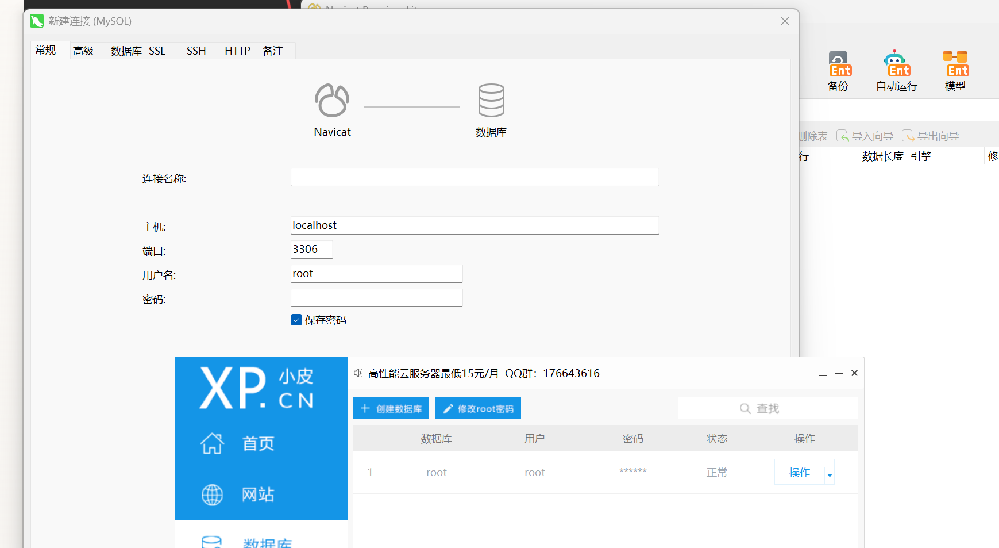

新建数据库`demo`，右击一下点打开数据库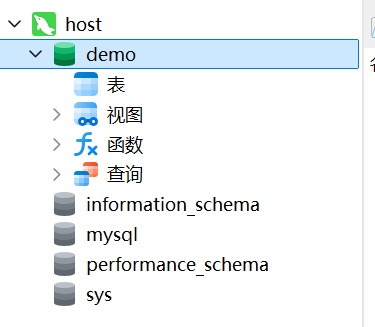

创造好之后点保存取名字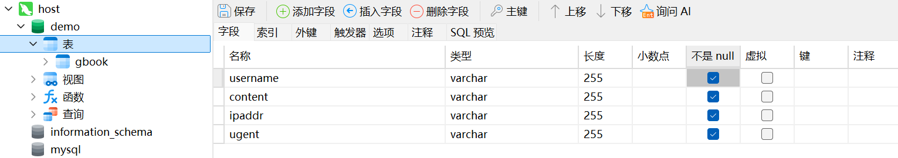

## PHP 开发核心知识点

`D:\phpstudy_pro\WWW`文件夹下创建个demo文件夹并用phpstorm打开

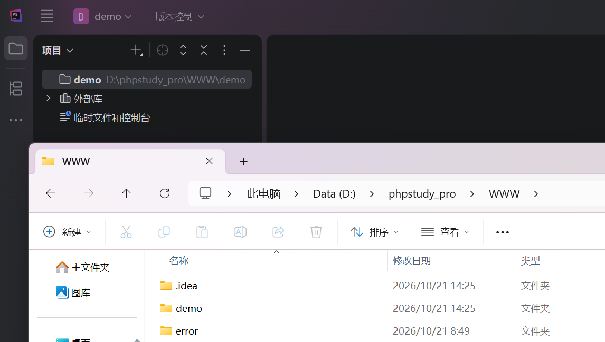

配置解释器，用小皮里的就可以

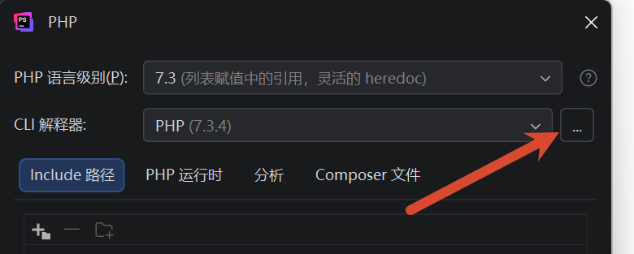

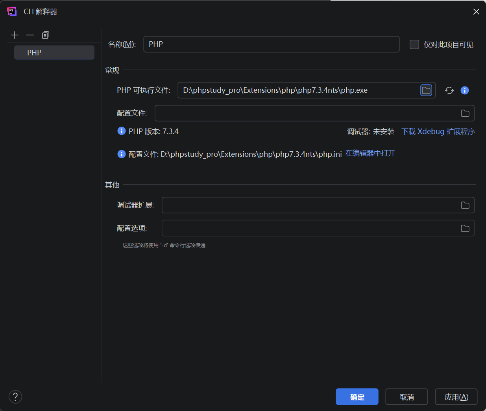


html表单写好之后，在php里代码里接收

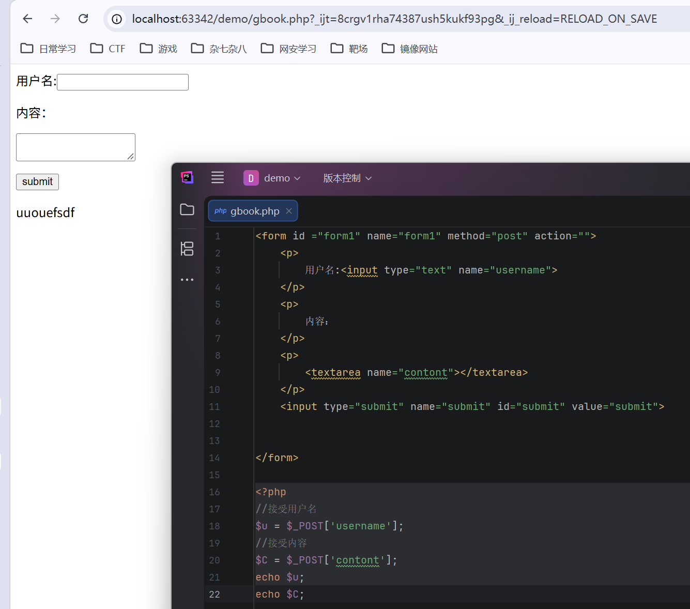

添加数据库通讯

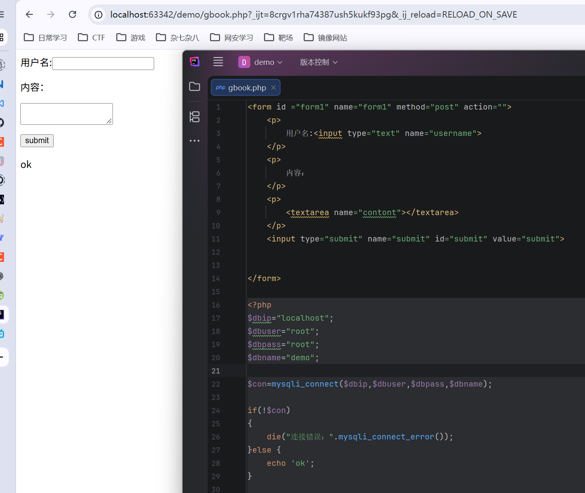

连接数据库后再写代码对数据库进行插入操作。注意哪怕我们不提交评论数据库也会有数据，因为ip。可以简单做一个判断用户有没有输入，这样就没垃圾数据了

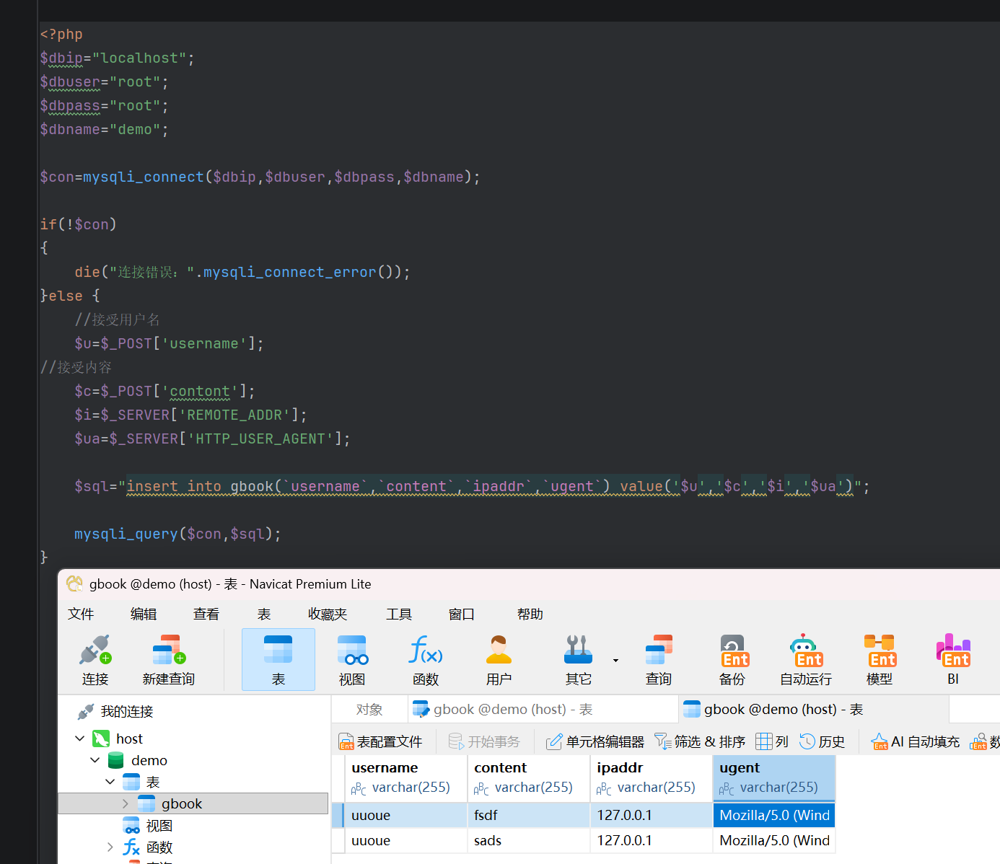

对数据进行查找

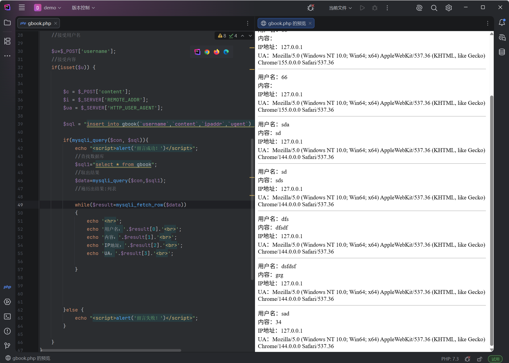

创建目录文件，将连接数据库文件已经查看后台数据的文件单独创建为一个文件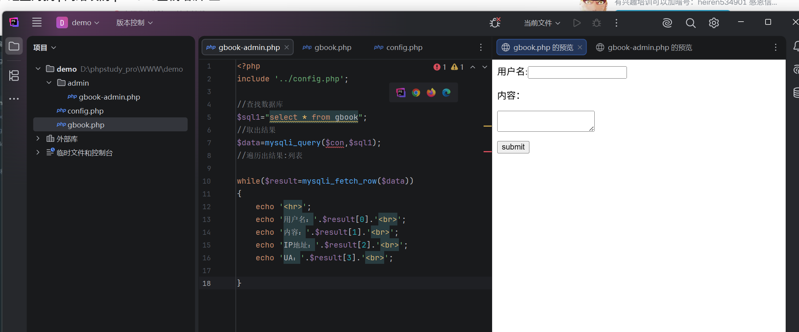

增加删除功能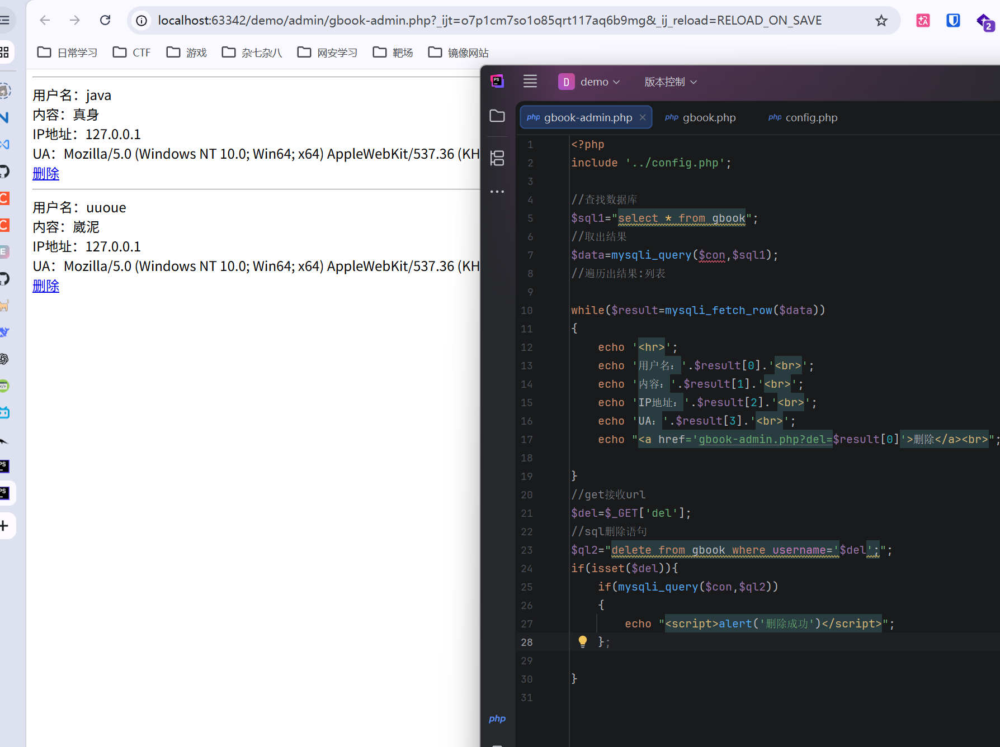

删除功能有个明显的问题，即我们删除之后，页面依旧会显示原来的数据 。这是因为向浏览器提交了？del后没有刷新，代码少了跳转功能。php执行时先进行查找输出到HTML上，直到执行到删除代码，才会删除，然后弹窗删除成功，但是没跳转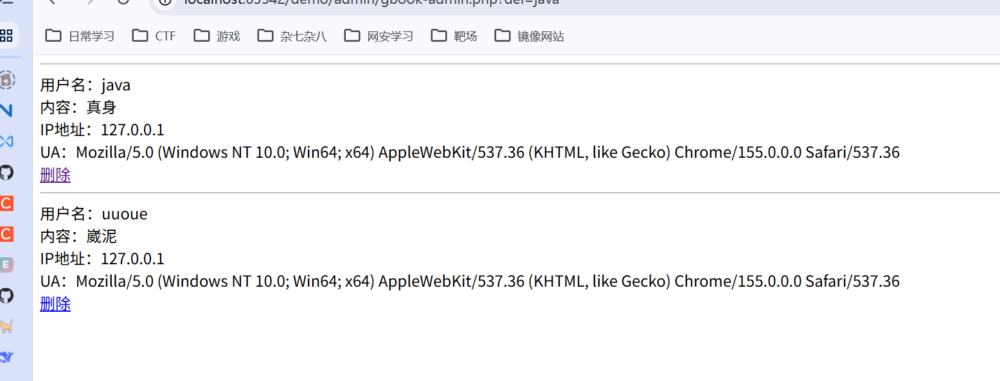

封装为函数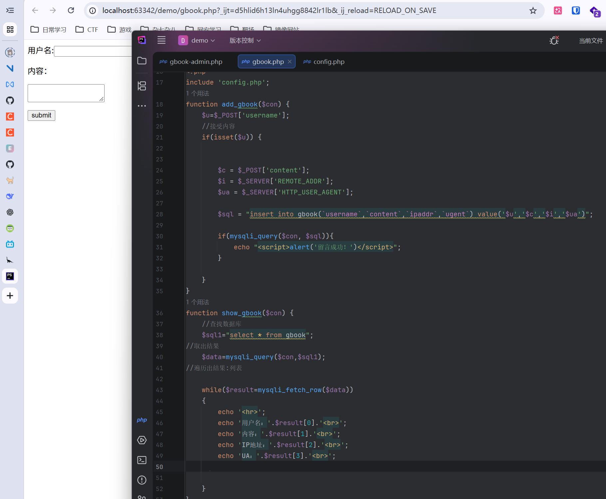

这代码我也只能说一言难尽吧

> gbook.php

```php+HTML
<form id ="form1" name="form1" method="post" action="">
    <p>
        用户名:<input type="text" name="username">
    </p>
    <p>
        内容：
    </p>
    <p>
        <textarea name="content"></textarea>
    </p>
    <input type="submit" name="submit" id="submit" value="submit">
</form>

<?php
include 'config.php';
function add_gbook($con) {
    $u=$_POST['username'];
    //接受内容
    if(isset($u)) {
        $c = $_POST['content'];
        $i = $_SERVER['REMOTE_ADDR'];
        $ua = $_SERVER['HTTP_USER_AGENT'];

        $sql = "insert into gbook(`username`,`content`,`ipaddr`,`ugent`) value('$u','$c','$i','$ua')";

        if(mysqli_query($con, $sql)){
            echo "<script>alert('留言成功！')</script>";
        }
    }
}
function show_gbook($con,$del) {
    //查找数据库
    $sql1="select * from gbook";
   //取出结果
    $data=mysqli_query($con,$sql1);
   //遍历出结果:列表

    while($result=mysqli_fetch_row($data))
    {
        echo '<hr>';
        echo '用户名：'.$result[0].'<br>';
        echo '内容：'.$result[1].'<br>';
        echo 'IP地址：'.$result[2].'<br>';
        echo 'UA：'.$result[3].'<br>';
        if($del == 'del'){
            echo "<a href='gbook-admin.php?del=$result[0]'>删除</a><br>";
        }
    }
}

add_gbook($con);
show_gbook($con,'x');
?>
```
> config.php

```php
<?php
$dbip="localhost";
$dbuser="root";
$dbpass="root";
$dbname="demo";
$con=mysqli_connect($dbip,$dbuser,$dbpass,$dbname);
?>

```
> gbook-admin.php

```php
<?php
include '../config.php';
include '../gbook.php';
show_gbook($con,'del');

//get接收url
$delstr=$_GET['del'];
//sql删除语句
$ql2="delete from gbook where username='$delstr';";
if(isset($delstr)){
    if(mysqli_query($con,$ql2))
    {
        echo "<script>alert('删除成功')</script>";
    };
}
?>
```

## 插件

 [**UEditor**](https://github.com/fex-team/ueditor#ueditor) 


- 将 UEditor 源码目录放到项目中。
- 在 HTML 页面底部引入两个核心 JS 文件。
- 在需要的地方实例化编辑器：
  \```javascript
  var ue = UE.getEditor('content'); // 'content' 是 textarea 的 id

## 安全意义

a. 编辑器本质上是一堆 **第三方 JS 代码** 和后台接口。如果编辑器本身存在漏洞（如文件上传漏洞），你的网站也会跟着沦陷。

b. 这些php都没有授权验证，普通用户都能访问后台

c. 如果 `$del` 没有经过过滤，直接拼接到 SQL 语句中，可能引发注入。

d. 如果 PHP 将其直接从数据库取出并 `echo` 到页面上，浏览器就会执行这段 JS 代码。这就构成了 XSS 漏洞。(这应该是被过滤了)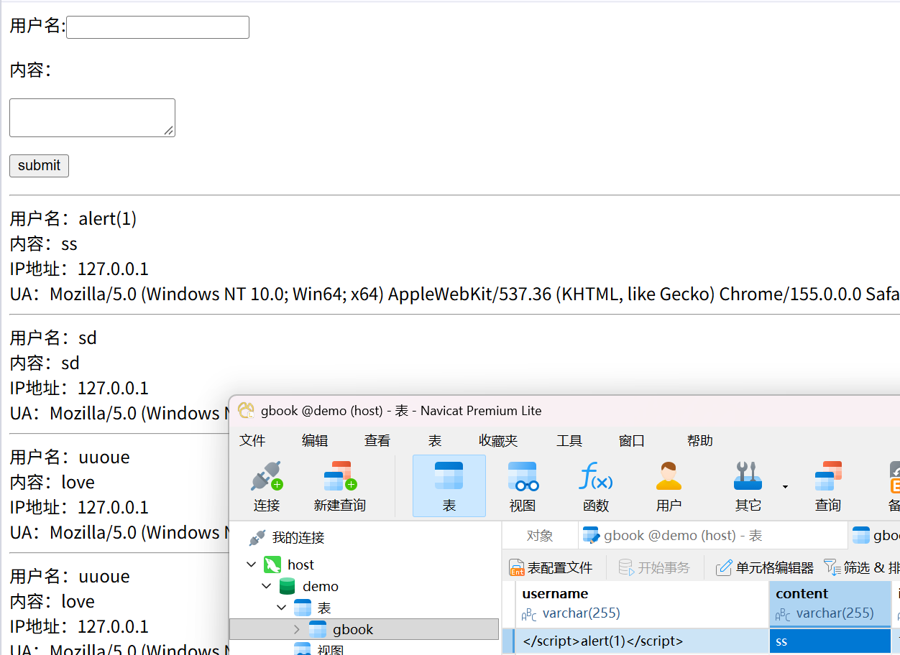


