# PHP-文件功能

## 文件上传

让deep seek写了html，结果也是难绷


### 无过滤文件上传

写php传文件

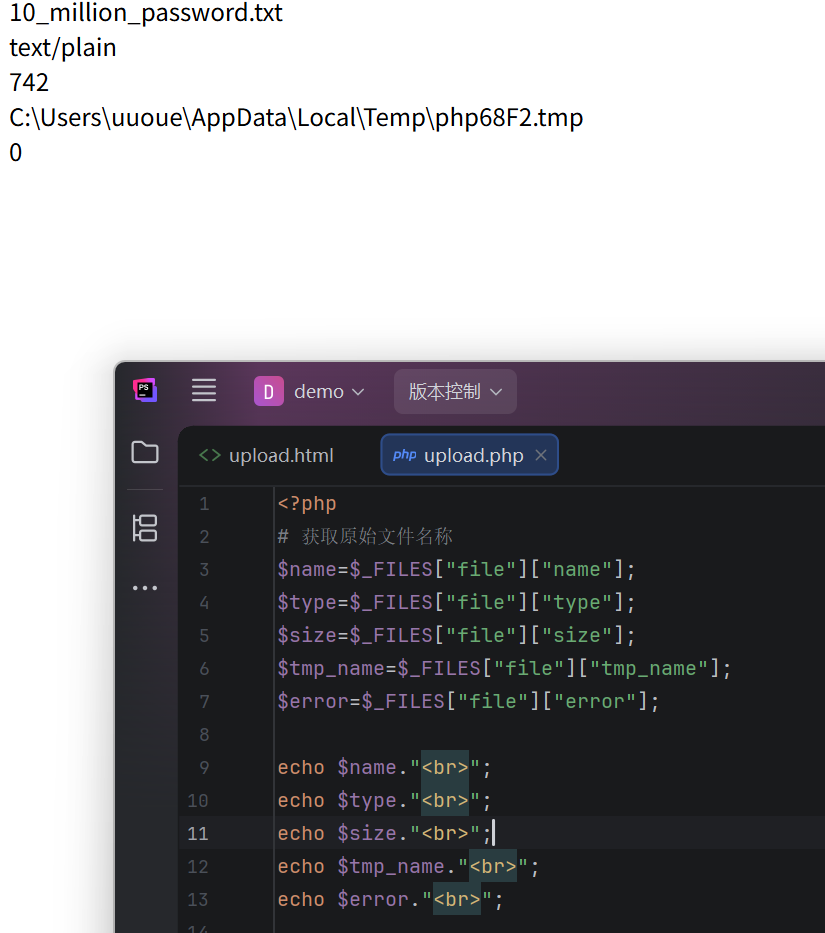


```text
$_FILES：PHP中一个预定义的超全局变量，用于在上传文件时从客户端接收文件，并将其保存到服务器上。它是一个包含上传文件信息的数组，包括文件名、类型、大小、临时文件名等信息。
$_FILES["表单值"]["name"] 获取上传文件原始名称
$_FILES["表单值"]["type"] 获取上传文件MIME类型
$_FILES["表单值"]["size"] 获取上传文件字节单位大小
$_FILES["表单值"]["tmp_name"] 获取上传的临时副本文件名
$_FILES["表单值"]["error"] 获取上传时发生的错误代码
move_uploaded_file() 将上传的文件移动到指定位置的函数
```

把文件上传到其他目录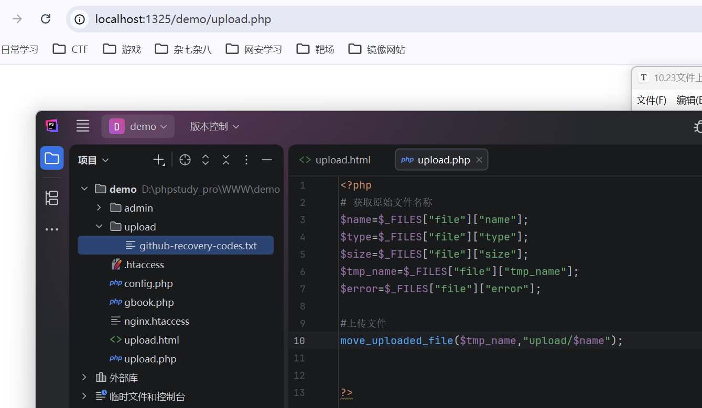

### 黑名单过滤


缺陷：

- 容易漏掉其他可解析后缀，如 `php5`、`phtml` 等。
- 是否可绕过与服务器环境、解析配置有关。
- 黑名单考虑不全时仍可能上传脚本文件。

测试上传png文件


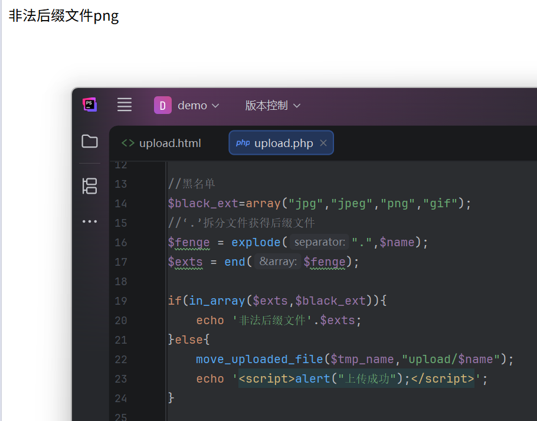

php文件被过滤，创造一个php5文件上传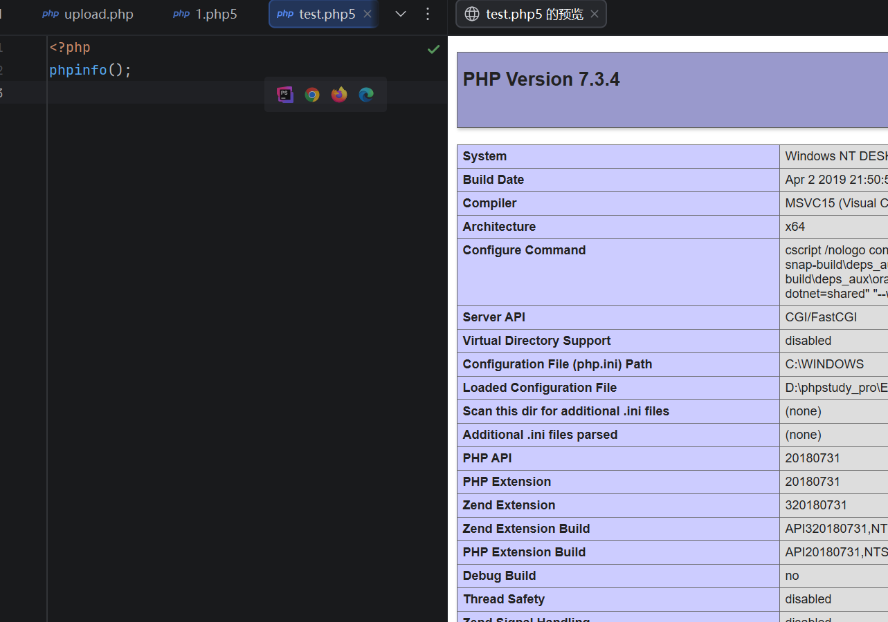

可访问，黑名单可绕过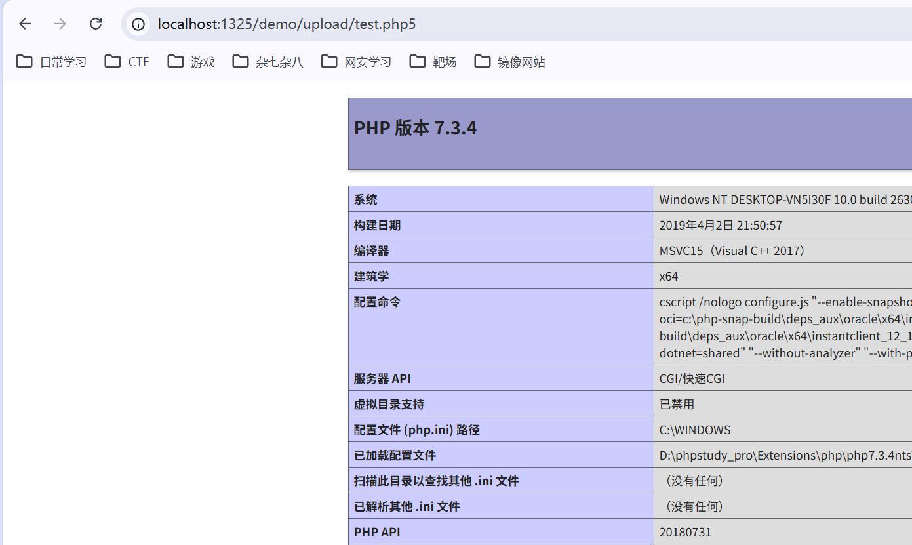

### 白名单过滤

特点：
- 比黑名单更安全。
- 只允许业务需要的文件类型。
- 但仍需结合 MIME、文件内容、重命名、目录权限等一起防御。

上传一个txt


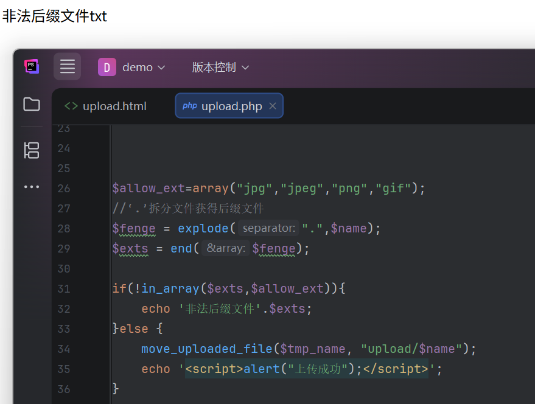

### 文件类型/MIME 过滤机制


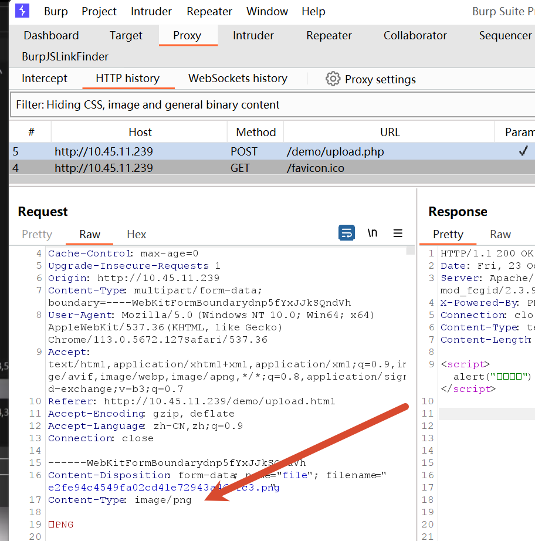

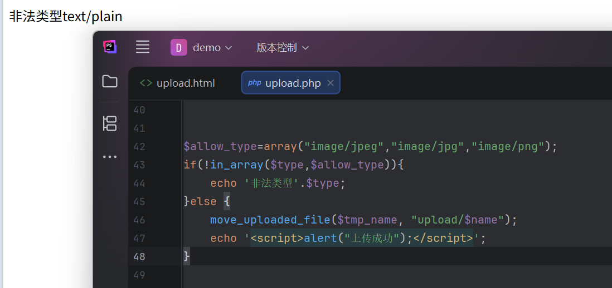

绕过也很简单，该包就行了。

## 文件管理

**文件管理模块-显示-过滤机制**
功能：显示 上传 下载 删除 编辑 包含等
1.打开目录读取文件列表
2.递归循环读取文件列表
3.判断是文件还是文件夹
4.PHP.INI目录访问控制

```text
is_dir() 函数用于检查指定的路径是否是一个目录
opendir() 函数用于打开指定的目录，返回句柄，用来读取目录中的文件和子目录
readdir() 函数用于从打开的目录句柄中读取目录中的文件和子目录
open_basedir：PHP.INI中的设置用来控制脚本程序访问目录
```

读取操作文件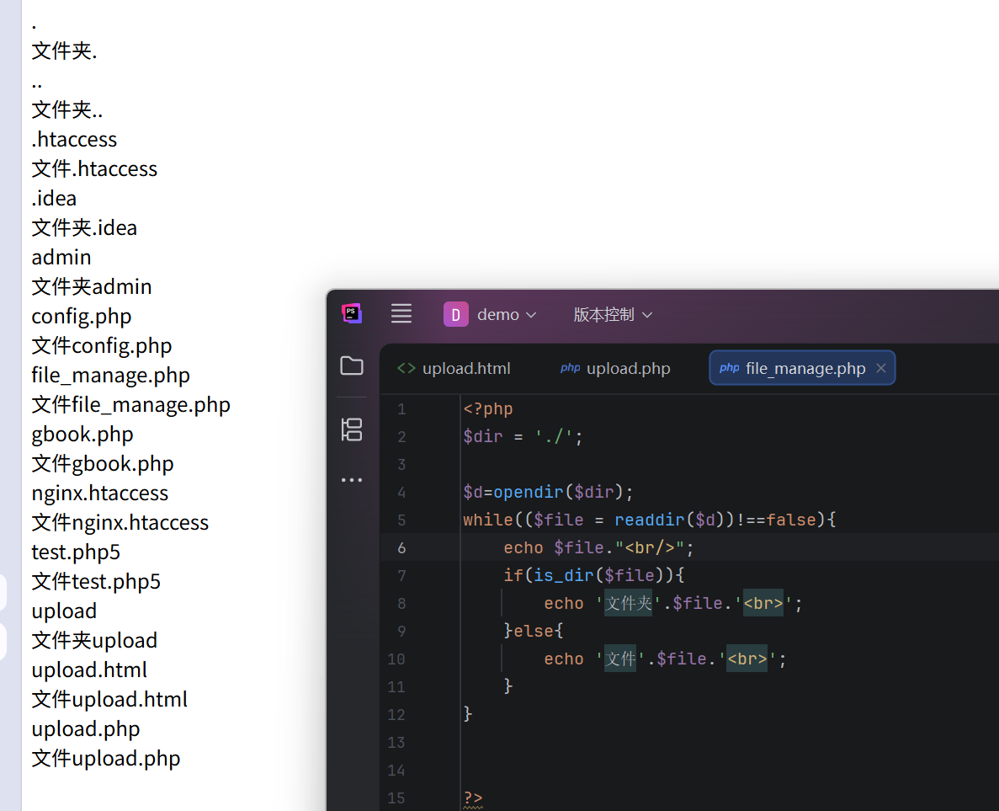

改了一下代码，域名指向也该了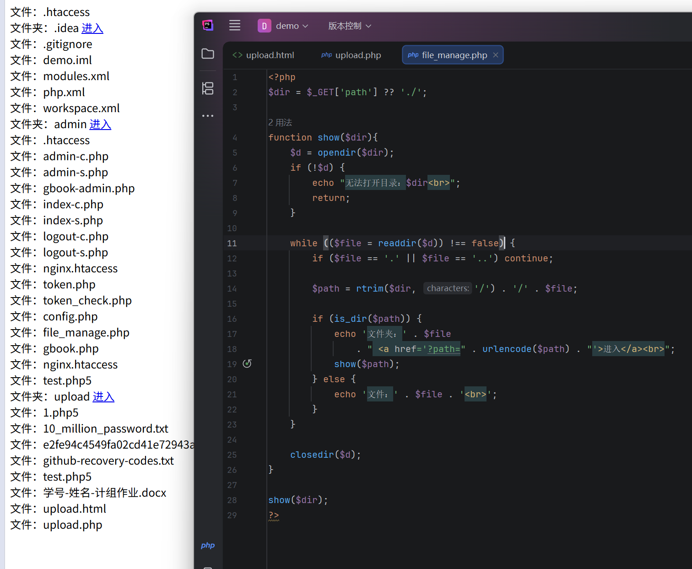
如果 `dir` 参数直接拼接且未过滤，可使用：

```text
../
..\
```

访问上级目录，甚至整个服务器目录。


我这个默认是注释不生效的.输入`../` 直接访问到上级目录`../../../`可访问上上级多个目录

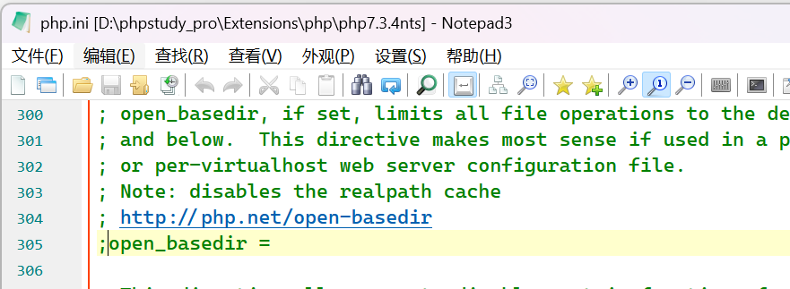

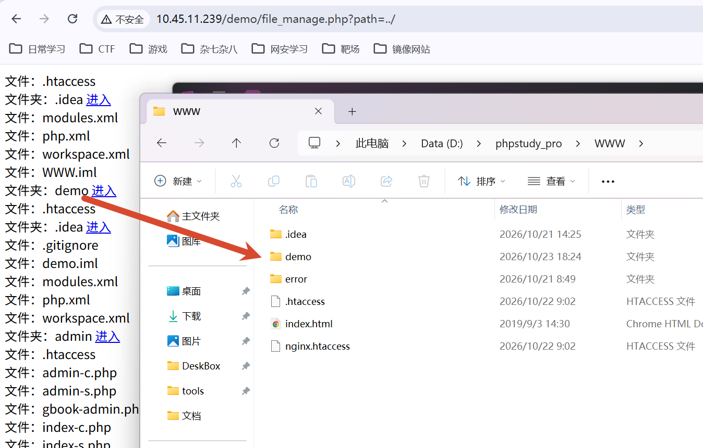

防御方式就是过滤

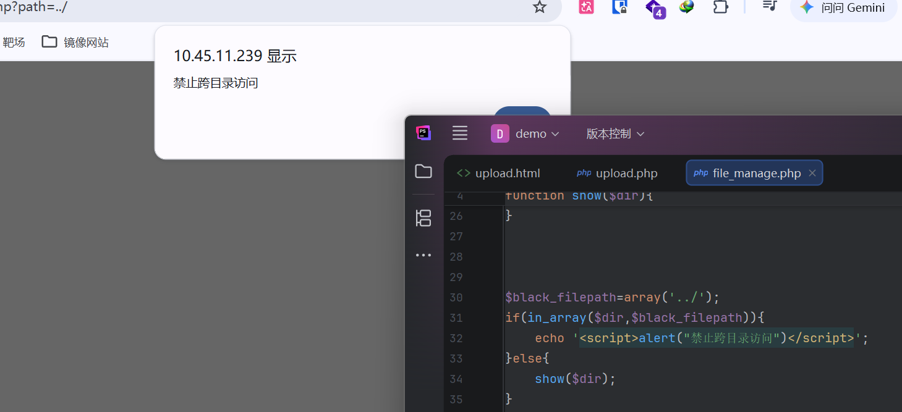
