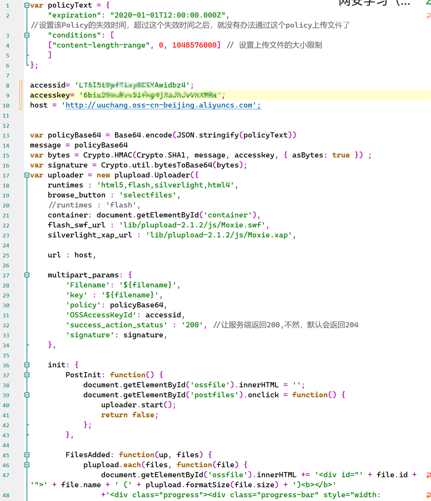
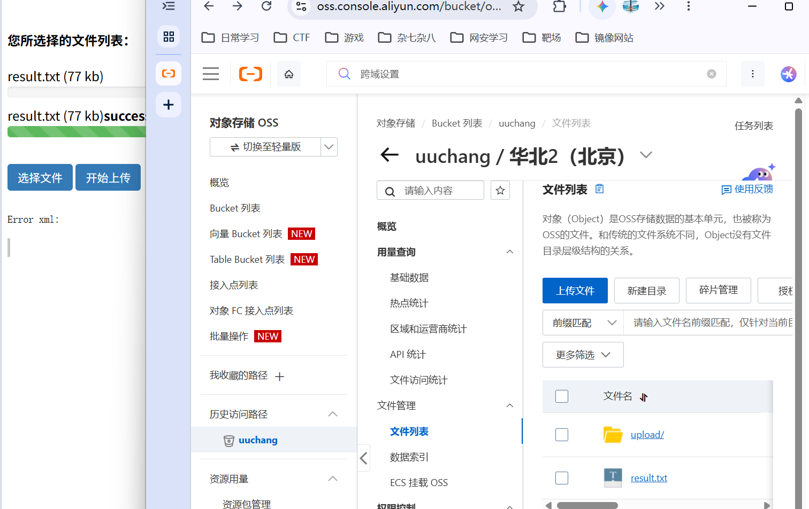
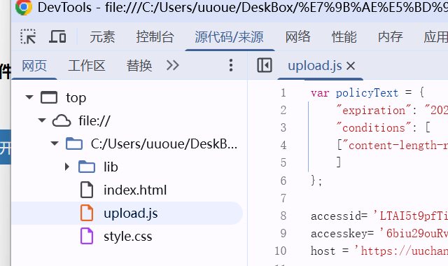
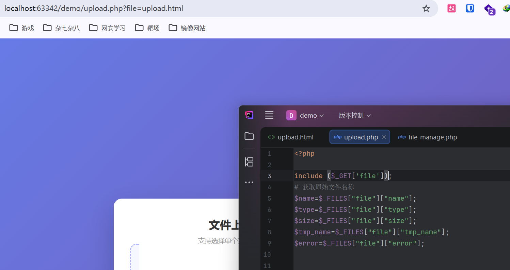
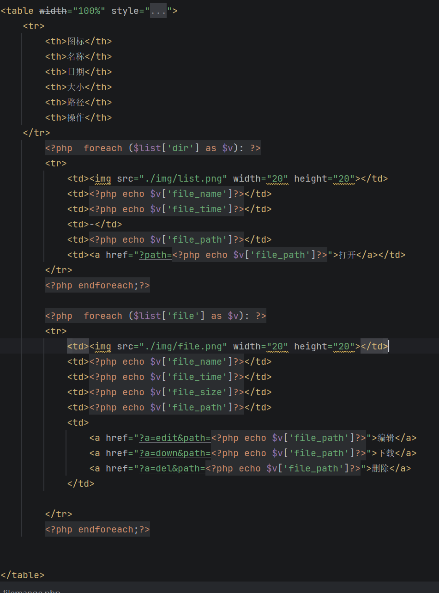

# PHP-文件管理


## 文件上传-上传构架补充


| 架构 | 说明 | 安全特点 |
|---|---|---|
| 上传到服务器本身磁盘（与源码在一起） | 文件和源码同服务器 | 文件可被解析，后门可执行，风险最高 |
| 云产品 OSS 对象存储 | 文件存到阿里云/腾讯云等 OSS | 文件只存储不解析，后门无法执行；但可能泄露 AccessKey |
| 上传到其他域名 | 如 `www.xiaodi8.com` → `upload.xiaodi8.com` | 独立存储域名，通常不解析脚本，风险较低 |

在阿里云搞个oss，填好Accesskey和host

数据安全下面跨域设置里面加一下规则，开启公共读写，就可以了



检查源码，发现可以看见js文件泄露的信息，很不安全

## 文件包含


| 函数 | 特点 |
|---|---|
| `include()` | 包含出错后脚本继续执行 |
| `require()` | 包含出错后脚本停止执行 |
| `include_once()` | 已包含则不再包含 |
| `require_once()` | 已包含则不再包含 |


如果包含的文件名来自用户可控参数：

```php
include （$_GET['file']）;
```




攻击者可以包含任意文件：

```text
?file=upload.html
?file=index.php
?file=1.txt
```


漏洞成因通用公式

> **可控变量 + 危险函数 = 漏洞**

- 可控变量：用户提交的恶意数据。
- 危险函数：决定漏洞类型。
  - 文件包含函数 → 文件包含漏洞
  - 文件上传函数 → 文件上传漏洞
  - 命令执行函数 → 命令执行漏洞
  - 文件删除函数 → 任意文件删除
  - 文件读取函数 → 任意文件读取

## 文件管理功能开发


```php
$list[$file_type][] = array( //$file_type = dir 和 file $list['dir'] 和  $list['file']
    'file_name'=>$file_name, //文件名存储键值file_name
    'file_path'=>$file_path, //文件路径存储键值file_path
    'file_size'=>round(filesize($file_path)/1024), //通过换算文件大小存储键值file_path
    'file_time'=>date('Y/m/d H:i:s',filemtime($file_path)), //获取文件时间并存储键值file_path
```


- 用 `foreach` 循环输出到页面。
- 根据 `type` 判断显示文件夹图标还是文件图标。



贴一下源码
```php+HTML
ini_set('open_basedir',__DIR__);


$path=$_GET['path'] ?? './';
$action = isset($_GET['a'])?$_GET['a']:'';
$path = isset($_GET['path'])?$_GET['path']:'.';
if(is_file($path))
{
    //获得文件名
    $file = basename($path);
    //获得路径
    $path = dirname($path);
}
//判断，不是目录
elseif(!is_dir($path))
{
    echo '我只会吃瓜！';
}
function getlist($path){
    $hd=opendir($path);
    while(($file_name=readdir($hd) )!== false){
        if($file_name != '.' && $file_name != '..'){
            $file_path = "$path/$file_name";
            $file_type = filetype($file_path);
        }
        $list[$file_type][] = array( //$file_type = dir 和 file $list['dir'] 和  $list['file']
            'file_name'=>$file_name, //文件名存储键值file_name
            'file_path'=>$file_path, //文件路径存储键值file_path
            'file_size'=>round(filesize($file_path)/1024), //通过换算文件大小存储键值file_path
            'file_time'=>date('Y/m/d H:i:s',filemtime($file_path)), //获取文件时间并存储键值file_path
        );

    }
    closedir($hd);
    return $list;
}

$list=getlist($path);


//接受方法 判断是怎么操作
//echo $action;
switch ($action){
    case 'del':
        unlink($file);
        //$cmd="del $file";
        //system($cmd);
        //echo $cmd;
        break;
    case 'down':
        header("Content-Type: application/octet-stream");
        header("Content-Disposition: attachment; filename=\"" . $file . "\"");
        header("Content-Length: " . filesize($file));
        readfile($file);
        break;
    case 'edit':
        $content=file_get_contents($file);
        echo '<form name="form1" method="post" action="">';
        echo "文件名：".$file."<br>";
        echo "文件内容：<br>";
        echo '<textarea name="code" style="resize:none;" rows="100" cols="100"">'.$content.'</textarea><br>';
        echo '<input type="submit" name="submit" id="submit" value="提交">';
        echo '</form>';
        break;
}

//检测编辑后提交的事件 进入文件重新写入
if(isset($_POST['code'])){
    $f=fopen("$path/$file",'w+');
    fwrite($f,$_POST['code']);
    fclose($f);
}


?>

<table width="100%" style="font-size: 10px;text-align: center;">
    <tr>
        <th>图标</th>
        <th>名称</th>
        <th>日期</th>
        <th>大小</th>
        <th>路径</th>
        <th>操作</th>
    </tr>
        <?php  foreach ($list['dir'] as $v): ?>
        <tr>
            <td></td>
            <td><?php echo $v['file_name']?></td>
            <td><?php echo $v['file_time']?></td>
            <td>-</td>
            <td><?php echo $v['file_path']?></td>
            <td><a href="?path=<?php echo $v['file_path']?>">打开</a></td>
        </tr>
        <?php endforeach;?>

        <?php  foreach ($list['file'] as $v): ?>
        <tr>
            <td></td>
            <td><?php echo $v['file_name']?></td>
            <td><?php echo $v['file_time']?></td>
            <td><?php echo $v['file_size']?></td>
            <td><?php echo $v['file_path']?></td>
            <td>
                <a href="?a=edit&path=<?php echo $v['file_path']?>">编辑</a>
                <a href="?a=down&path=<?php echo $v['file_path']?>">下载</a>
                <a href="?a=del&path=<?php echo $v['file_path']?>">删除</a>
            </td>

        </tr>
        <?php endforeach;?>
        
```

### 核心知识点

- `$_GET`：获取 URL 参数
- `is_file()`、`is_dir()`：判断文件或目录
- `opendir()`、`readdir()`：遍历目录
- `switch`：根据操作类型执行不同逻辑
- `unlink()`：删除文件
- `file_get_contents()`：读取文件内容
- `fwrite()`：写入文件内容
- `foreach`：遍历文件列表

### 文件下载：
- 修改HTTP头实现文件读取解析下载：
  - header("Content-Type: application/octet-stream");
    header("Content-Disposition: attachment; filename="");
    header("Content-Length: " . filesize($file));
    readfile($file);

### 文件编辑：
1、file_get_contents() 读取文件内容
2、fopen() fread() 文件打开读入


## 文件管理功能的安全问题

1. 目录遍历

- `path` 参数可控，可用 `../` 跨目录。
- 可浏览服务器任意目录，甚至 C 盘。
- 造成信息泄露。

2. 任意文件读取

- 编辑功能读取文件内容。
- 若路径可控，可读取任意文件。

3. 任意文件下载

- 下载功能路径可控。
- 可下载服务器任意文件，如配置文件、源码。

 4. 任意文件删除

- 删除功能路径可控。
- 可删除服务器任意文件，甚至整个目录内容。

5. 任意文件写入/编辑

- 编辑功能路径可控。
- 可写入任意文件，可能写入后门。

6. 命令执行

- 如果删除使用 `system("del " . $file)` 等系统命令。
- 参数可控时可能造成命令注入。
- 例如：

```text
?path=1.txt & ping xxx
```

- 命令拼接不当可执行任意系统命令。

7. 漏洞成因


> **可控变量 + 危险函数 = 漏洞**

- 使用 `unlink` → 任意文件删除
- 使用 `system` → 命令执行
- 使用 `file_get_contents` → 任意文件读取
- 使用 `readfile` + 下载头 → 任意文件下载
- 使用 `fopen` + `fwrite` → 任意文件写入


---


> 最近写python有点力竭了，无力直视php，代码直接拿的老师的。
