# JS前端开发与安全审计

[原生JS教程](https://www.w3school.com.cn/js/index.asp)  [jQuery库教程](https://www.w3school.com.cn/jquery/index.asp) 需要JS知识，最好学一下。

## JS 原生开发：文件上传验证

**核心流程**：

1. **HTML 页面**：提供 `<input type="file">` 文件选择框，并绑定 `onchange` 事件。
2. **JS 前端验证**：当用户选择文件后，触发 JS 函数。利用字符串处理函数（如 `lastIndexOf('.')` 和 `substring()`）提取文件的后缀名，并通过 `for` 循环遍历白名单数组（如 `['jpg','png','gif']`）。如果符合白名单则允许提交，否则弹窗提示错误并刷新页面。
3. **PHP 后端处理**：验证通过后，表单提交给 `upload.php`，由 PHP 将文件从临时目录移动到上传目录。

---

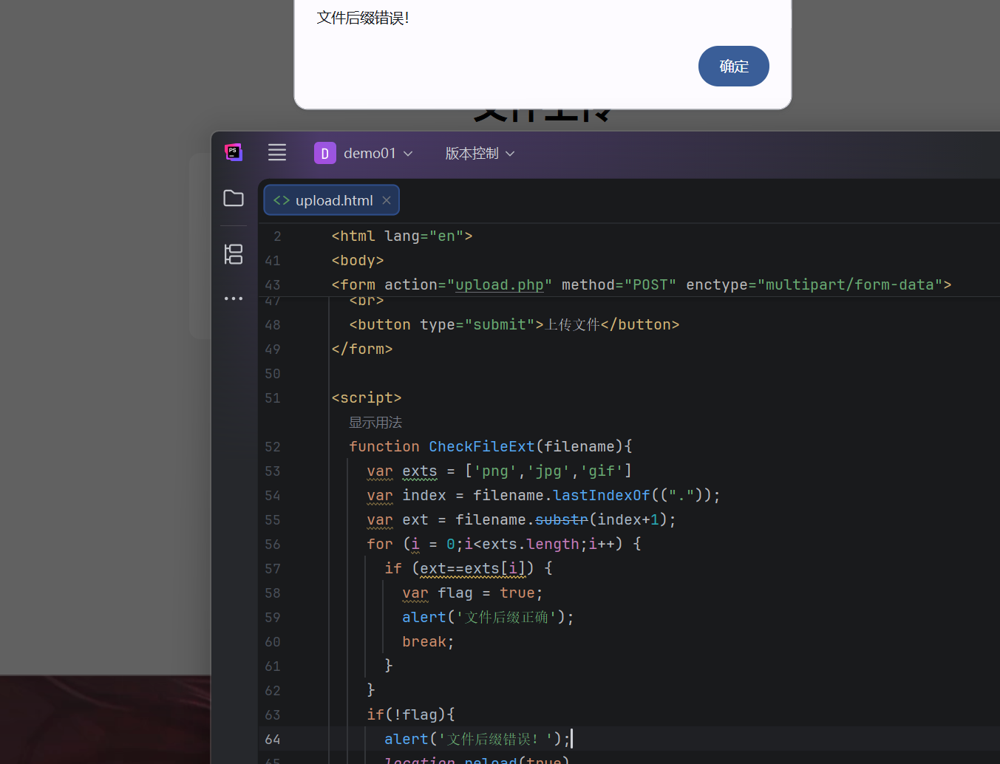

>onchange:[参考文章](https://www.runoob.com/jsref/event-onchange.html) 简单来说就是事件会跟着改变。
>lastIndexOf("."): [参考文章](https://www.w3schools.com/jsref/jsref_lastindexof.asp)获取指定值的索引
>substr(index+1)：[参考](https://www.runoob.com/jsref/jsref-substr.html)从指定位置提取字符串
>location.reload(true)：[参考](https://www.runoob.com/jsref/met-loc-reload.html)强制服务器刷新页面

**安全隐患**：
前端 JS 代码是明文的，任何人通过浏览器查看源码就能看到验证逻辑。攻击者只需**禁用浏览器 JS**，或将网页源码保存到本地**删除验证代码**，即可绕过前端校验，直接将恶意脚本（如 `.php` 木马）提交给后端。如果后端没有再次进行安全过滤，就会导致任意文件上传漏洞。

---

1.可直接查看源码

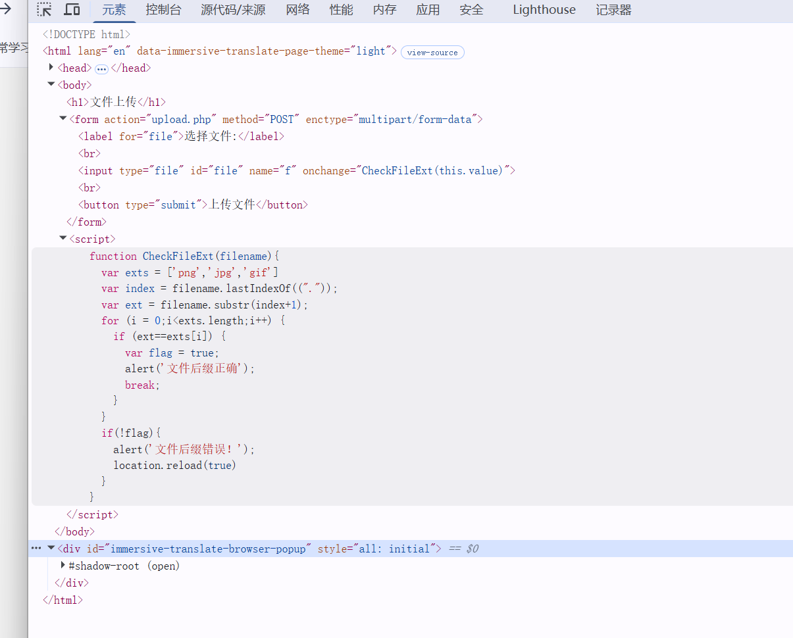

2.右键查源代码，删除验证语句

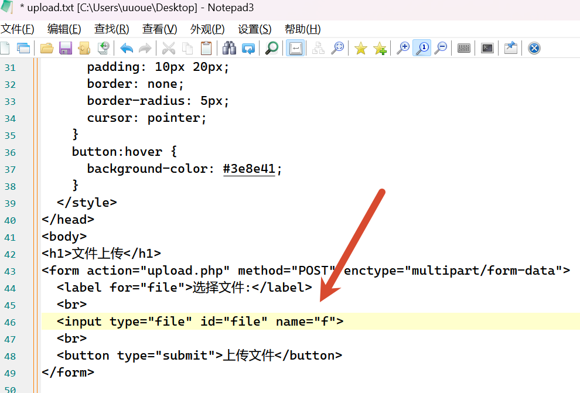

改成html格式浏览器打开，把上传路径改一下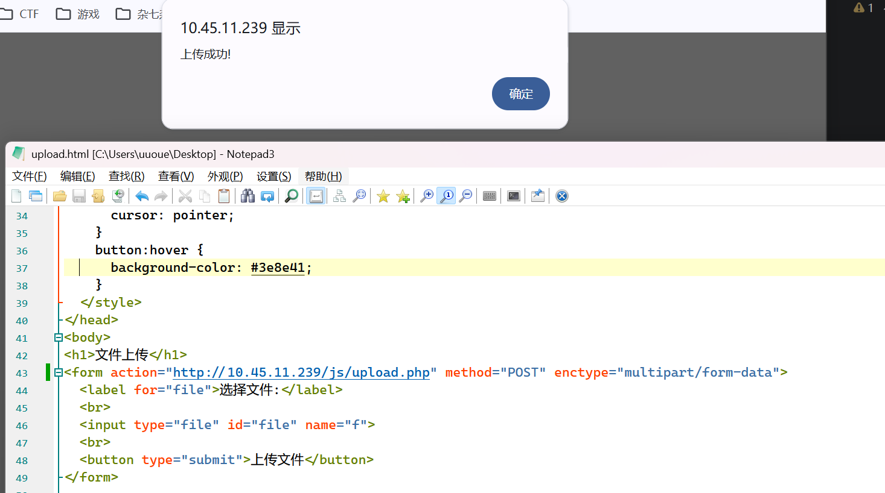

## JQuery 库开发

### 登录验证与 Ajax

**核心流程**：
1. 引入 JQuery 库。
2. 绑定登录按钮的点击事件。
3. 使用 `$.ajax` 发送请求，将前端获取的账号密码（通过获取 DOM 元素的 `class` 值）以 POST 方式发送给后端（如 `logincheck.php`）。
4. 后端 PHP 验证账号密码，返回 JSON 格式的数据（如 `{"infoCode": 1, "msg": "OK"}`）。
5. 前端在 `success` 回调函数中解析返回的 JSON。如果 `infoCode == 1`，则弹窗提示“登录成功”并跳转首页；否则提示“登录失败”。

---

改成按钮就可以触发特定函数

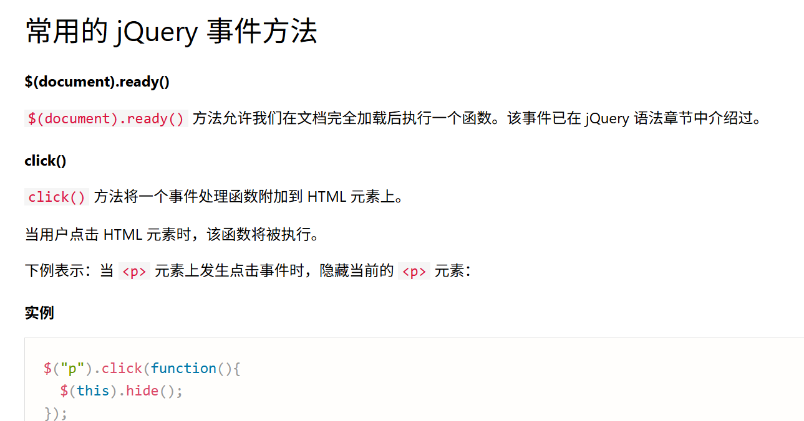

发送数据函数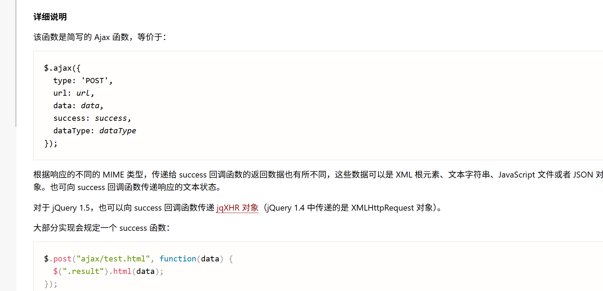

获得内容通过一下val,传class的值

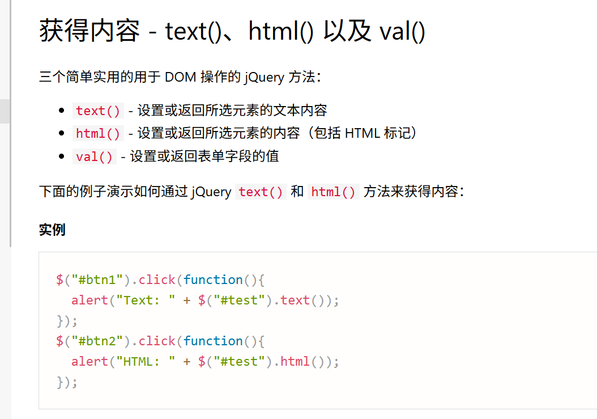

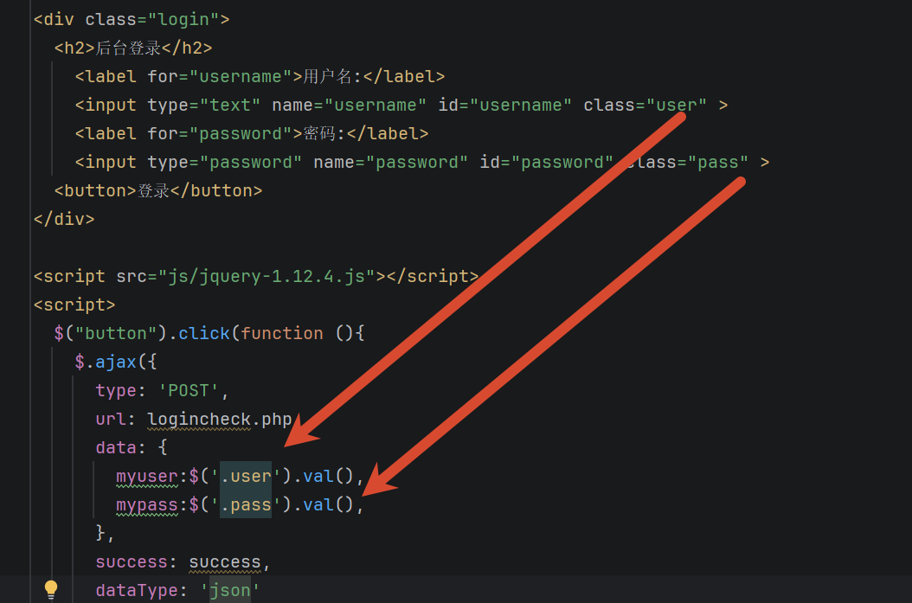

success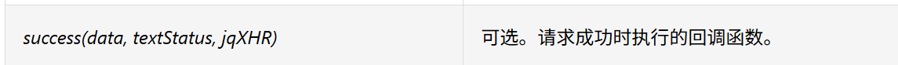

获取数据库真实信息，得到返回值，最后转换成json编码是因为上面配置的文件类型是json

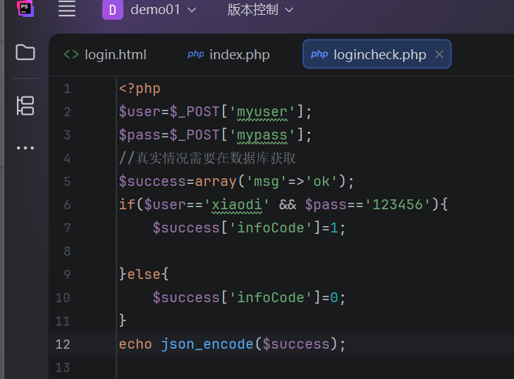

添加代码在控制台查看

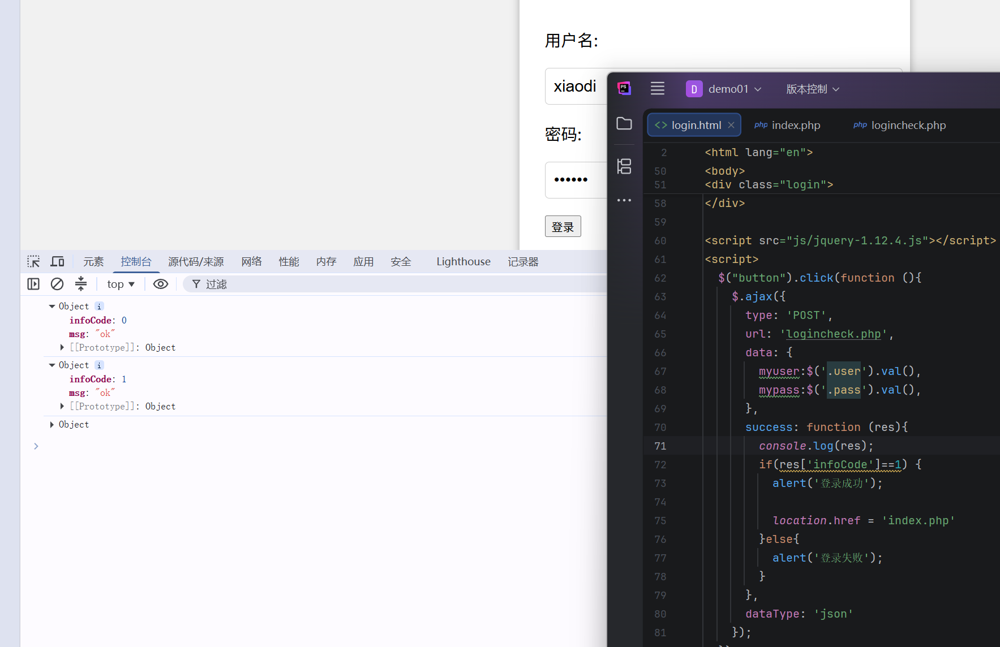

**安全隐患（逻辑漏洞）**：
由于前端高度依赖后端返回的 `infoCode` 值来执行跳转，攻击者可以使用抓包工具（如 Burp Suite）拦截后端返回的响应包，将 `infoCode` 从 `0`（失败）强行修改为 `1`（成功）。前端 JS 接收到被篡改的数据后，会误以为登录成功，从而执行跳转逻辑进入后台。

---

处理操作写在js里面是不安全的，攻击者可以清楚的知道当infoCode=1时就可登录成功

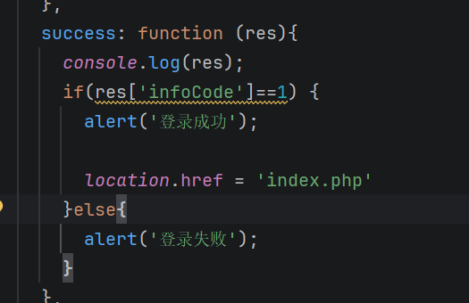

抓包,然后抓返回包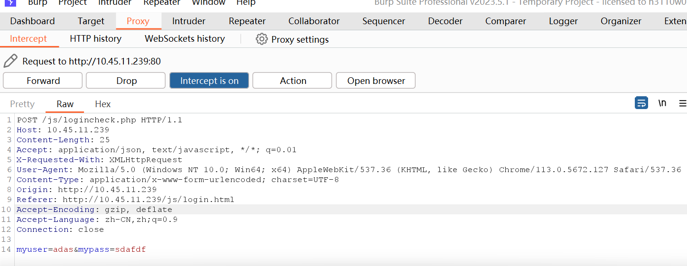

右键->Do intercept->Respense to this request.然后吧包放出去抓到返回包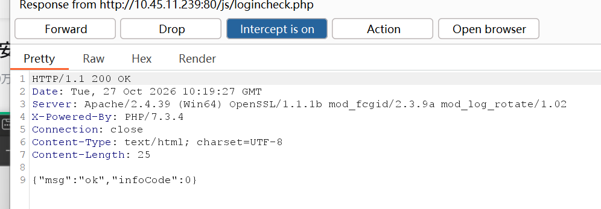

改成1，发送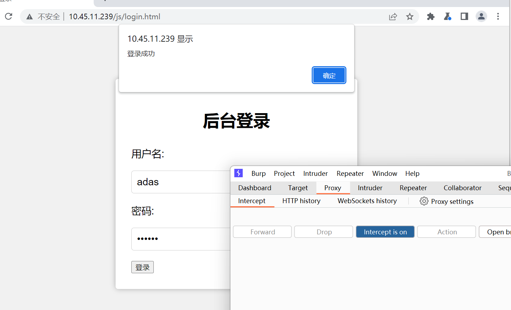

把判断改到php里，跳转根据==账号密码的判断==才安全。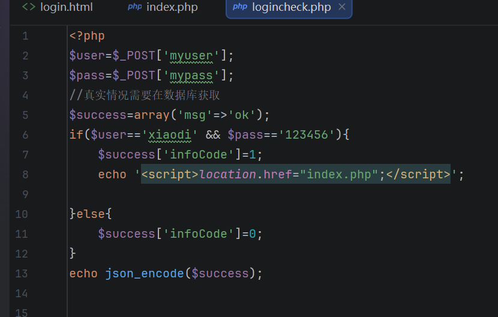

再次抓包修改数值，显示登录成功，但是没跳转页面

---

### 逻辑购买

与登录验证类似，商品购买等涉及金钱交易的业务，如果在后端校验不严，也会产生严重问题。

弄好html和php后抓包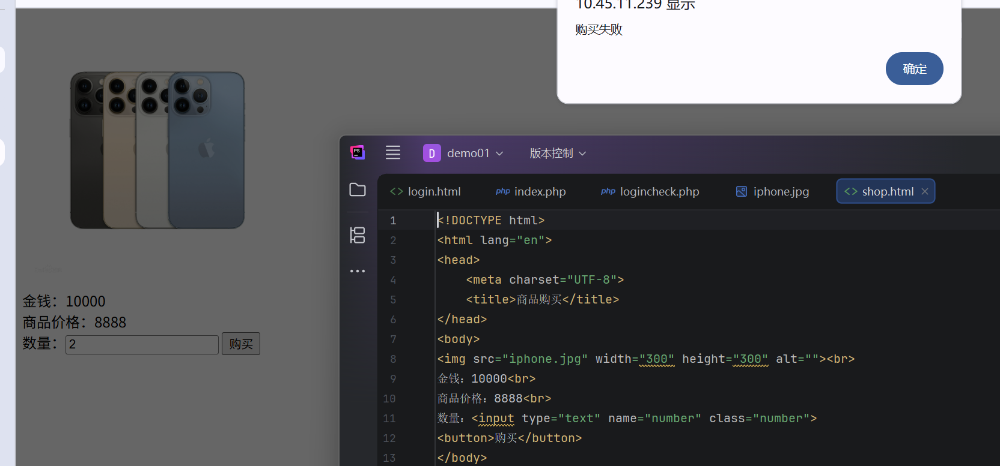

强制改成1，显示购买成功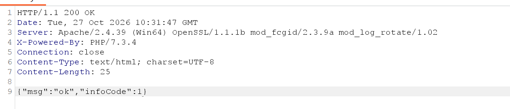

## APP案例演示

这软件似了喵

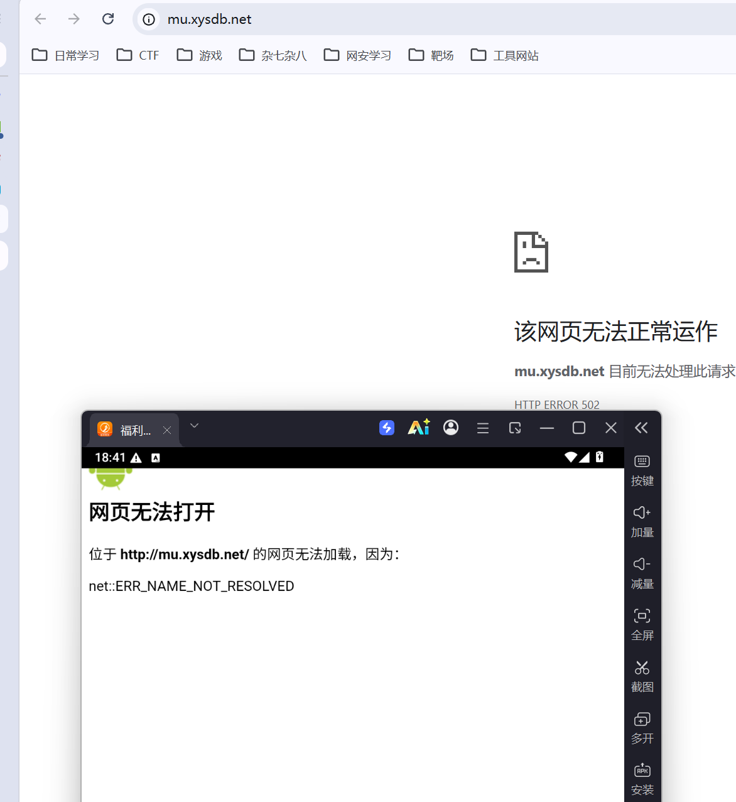
