# DOM树

**DOM（Document Object Model，文档操作对象）**：浏览器提供的一套专门用来操作网页代码内容的功能，实现自主或用户交互的动作反馈。就是用来**获取、修改网页代码中的内容**。

1. 获取对象

```js
<h1 id="myHeader" onclick="getValue()">这是标题</h1>
document.querySelector('h1 //标签：直接写
document.querySelector('.id') //Class：加上符号.
document.querySelector('#myHeader') //id：加上符号#
```

2. 获取对象属性

```js
const h1 = document.querySelector('h1')
const id = h1.id
console.log(id)
```

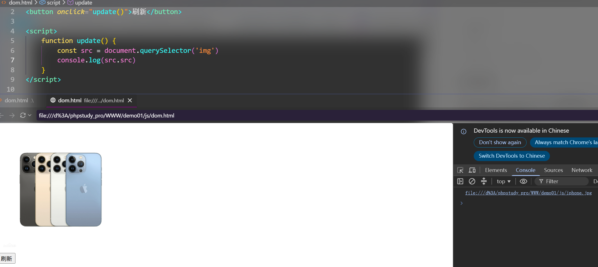


3. 操作元素数据

| 方法      | 说明           |
| --------- | -------------- |
| innerHTML | 解析后续代码   |
| innerText | 不解析后续代码 |

**解析后续代码** 点击标题，文字变成小迪，且<hr>代码被解析

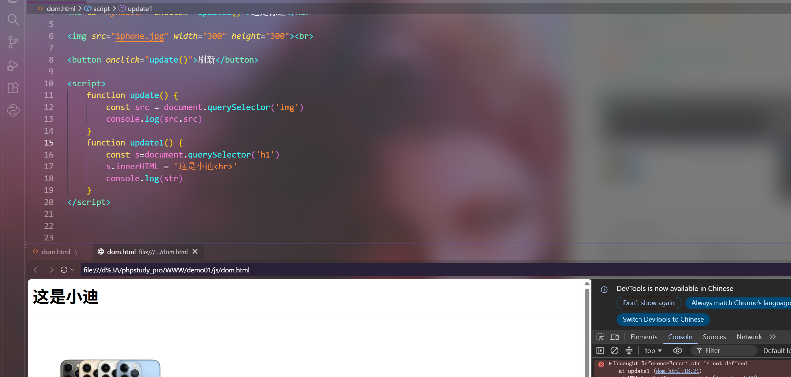

**不解析后续代码**，点击标题，hr没有被解析

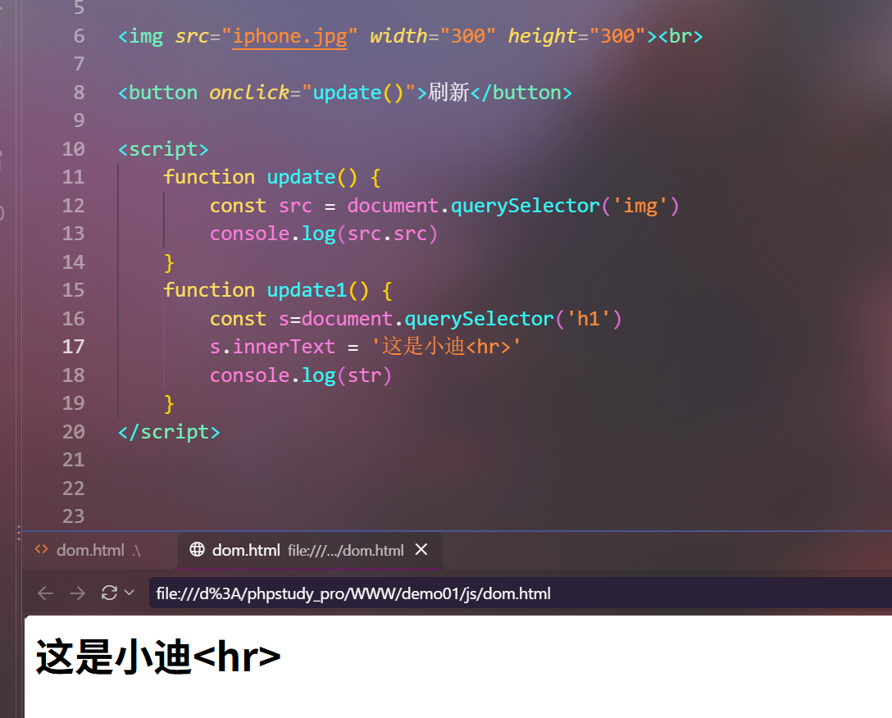

4. 操作元素属性

```js
</img>
const src = document.querySelector('img')
src.src = 'huawei.png'
```

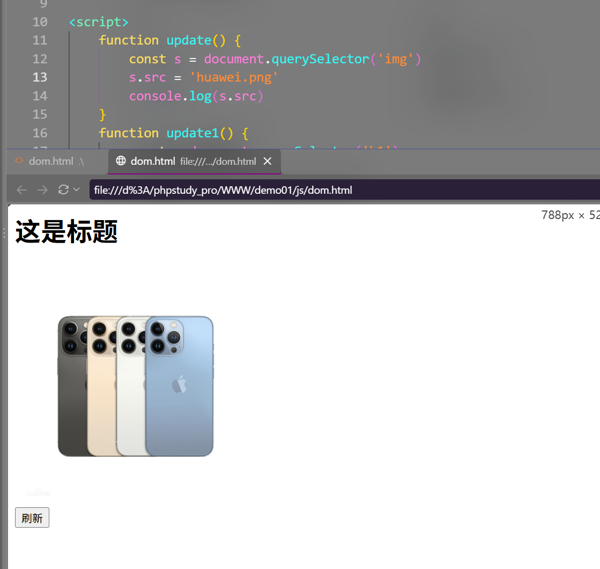

5. DOM-XSS安全问题

本身的前端代码通过DOM技术实现代码的更新修改，但是更新修改如果修改的数据可以由用户来指定，就会造成DOM-XSS攻击！


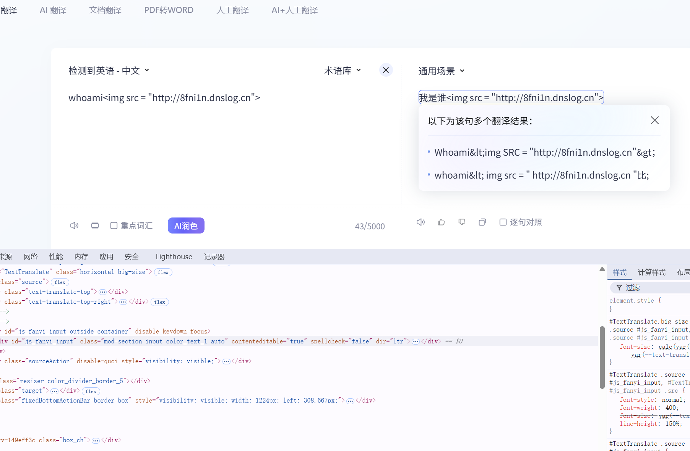

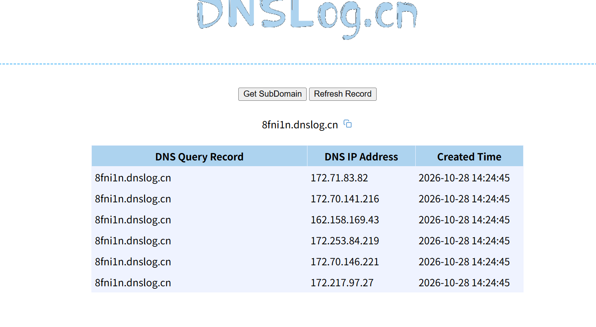

有请求文件，但是时间上对不上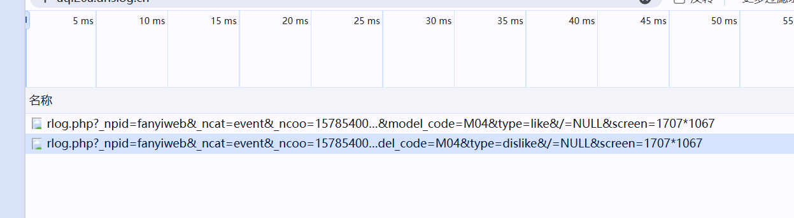

# 逆向调试

为什么学加密

- 漏洞测试（如 SQL 注入 payload）需要**按目标网站的加密算法发送密文**
- 若不知道加密算法，发送明文 payload → 对方无法解密 → **没有测试资格**
- 网站使用加密传输是其"看起来安全"的原因之一
- 加密函数均为第三方库封装，掌握库的调用规则即可

加密解密

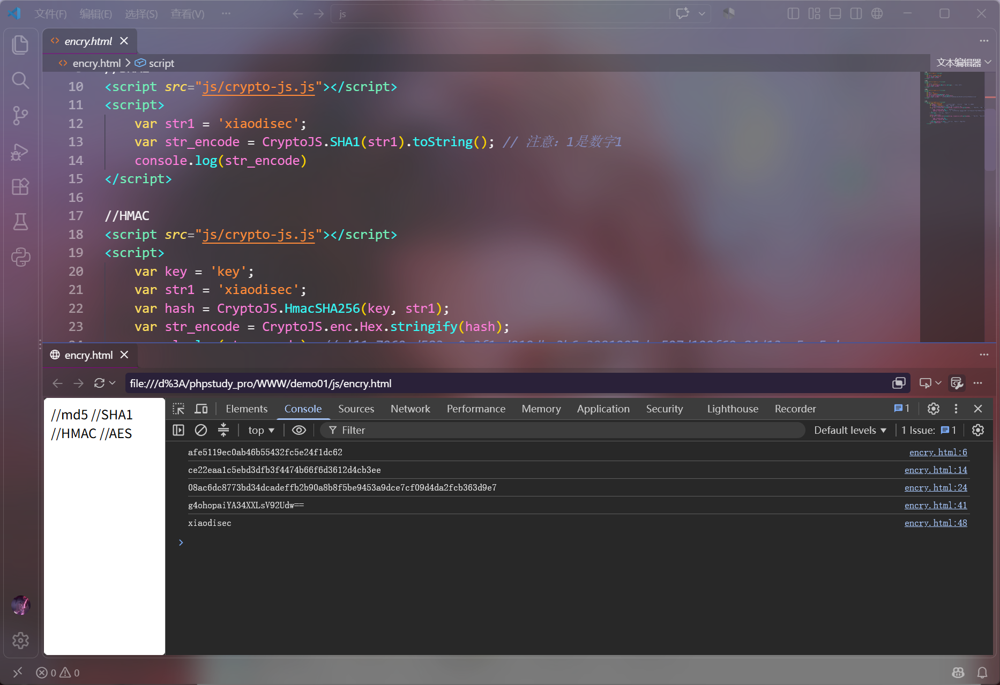

小迪的网站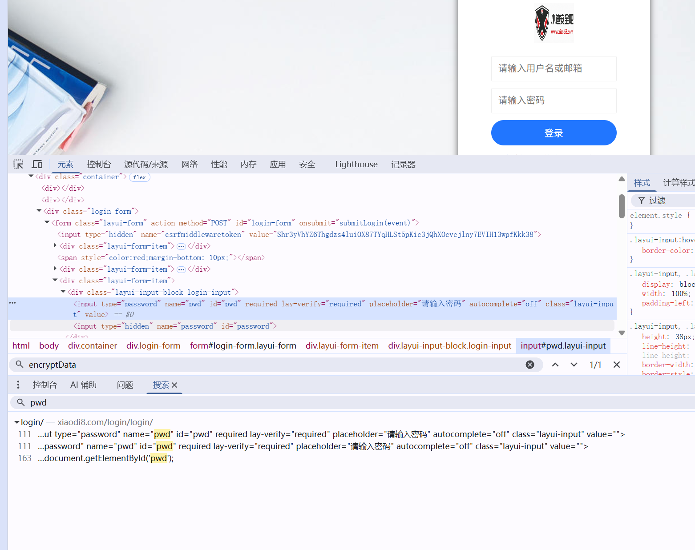

全局搜索function encryptData

代码看不懂可以问ai，思路和小迪说的差不多。这个网站思路是**密文 = Base64( IV + AES_CBC(明文, 密钥) )**

打上断点输入登录密码，控制台写encryptionKey

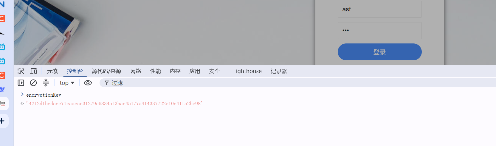

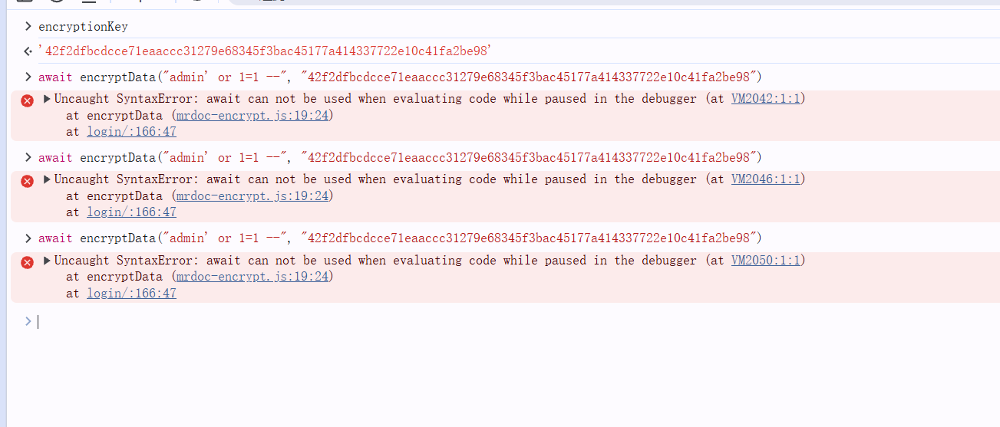

大概就这个流程

