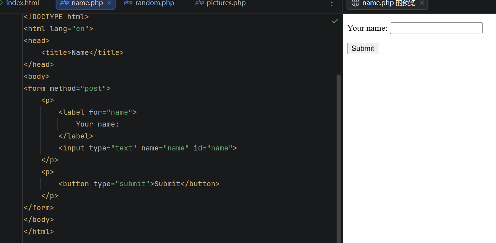
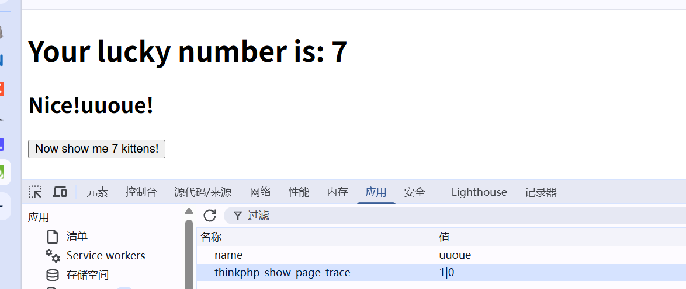
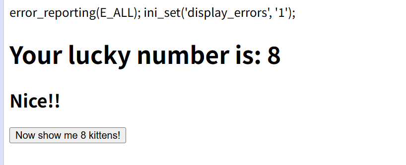
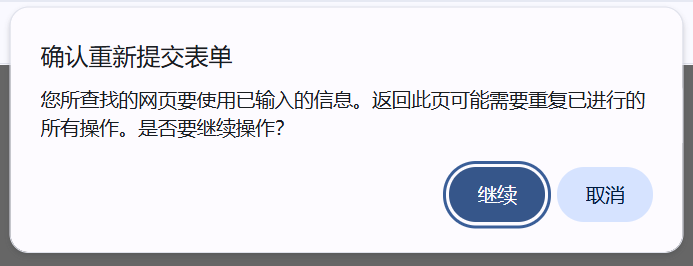
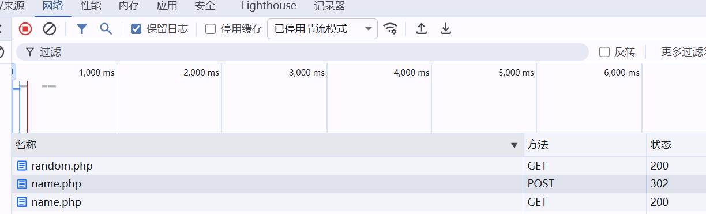

# Cookies Cookie

---

## Cookie的用途

HTTP协议处理的请求无记忆，服务器处理请求时，响应发送完毕就会忘记这个请求，并开始处理下一个请求。Cookie就是解决这个问题

创建一个name.php文件，提交表单。

为了让名字在后续请求中可用，我们应该设置一个 Cookie。这样我们就能告诉浏览器记住用户的名字，并在用户发出下一个请求时把它发送回服务器。我们先来看看实际效果。添加以下代码：

```php
<?php
if (isset($_POST['name'])) {
    setcookie('name', $_POST['name']);
}
?>
```

> [!IMPORTANT]
>
> 放在文件头部的原因：
>
> 服务器发送响应时发送的正文由PHP脚本组成（不在<?php和？>之间的内容）服务器是先发送响应，然后再发送正文，一旦开始发送正文，就无法添加响应。由于 `setcookie()` 会设置响应头，因此应在输出任何 HTML 之前调用此函数。[例子](#tag)

PHP服务器可以从请求中获取`Cookie`标头,并生成键值对菽粟。 在random文件里添加`name` cookie。
```php
<h1>Your lucky number is: <?php echo $randomInt; ?></h1>
<?php if ($randomInt > 5) { ?>
    <h2>Nice, <?php
        echo htmlspecialchars($_COOKIE['name'], ENT_QUOTES);
    ?>!</h2>
<?php } ?>
```

打开网站输入名字，就可以在random里看见自己的名字来。接下来来处理输入名字前，网站没有cookie传入的情况。右键删除原有cookie

刷新

有两种方法可以预防这种情况

```php
f (isset($_COOKIE['name'])) {
    echo ', '
        . htmlspecialchars($_COOKIE['name'], ENT_QUOTES);
}
```

```php
<h2>Nice, <?php
echo htmlspecialchars($_COOKIE['name'] ?? 'anonymous user', ENT_QUOTES);
?>!</h2>
```


把<a id=tag>setcookie</a>放在文件最下方


## POST请求后进行重定向

用户提交表单需要刷新页面，而浏览器总是弹出这种页面，给用户增加了负担

标准解决方案是将浏览器重定向到一个可以安全刷新的页面。就是GET请求，name文件添加一下代码

```php
<?php
if (isset($_POST['name'])) {
    setcookie('name', $_POST['name']);
    header('Location: /random.php');
}
?>
```

header()函数手动向响应添加标头 。`Location` 标头是一种特殊标头，它告诉浏览器发出新的请求。这个新请求是GET请求。通常使用完 `header('Location: ...')` 后需要添加`exit;` 语句。

开启‘保留日志’，观察新请求




