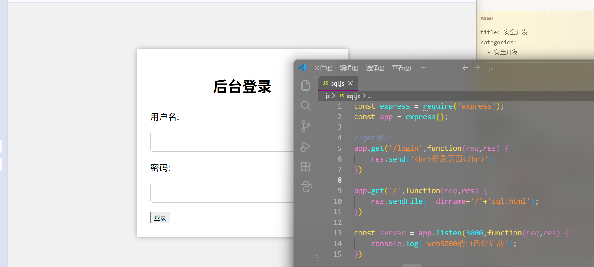
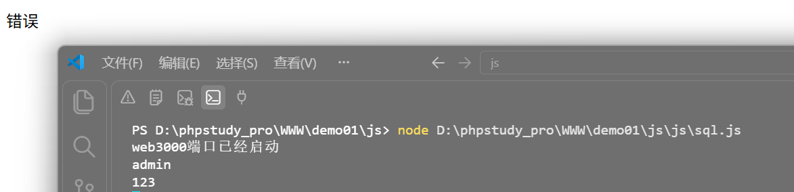
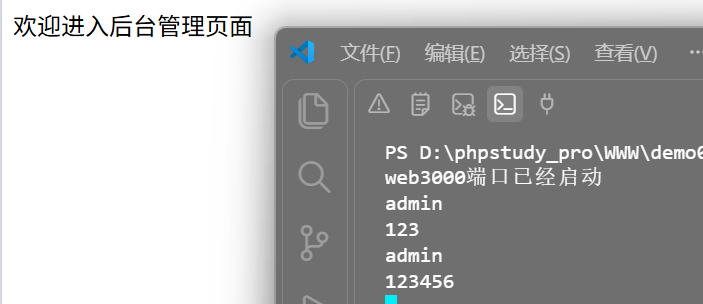
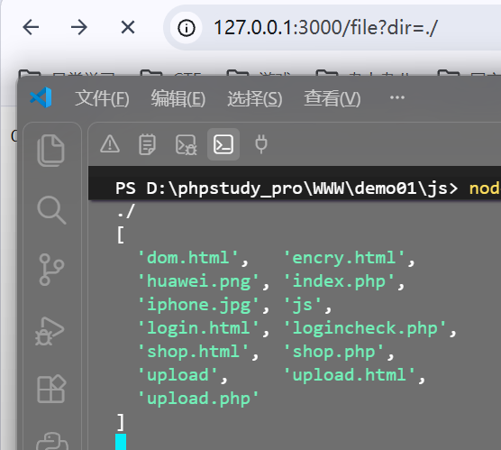
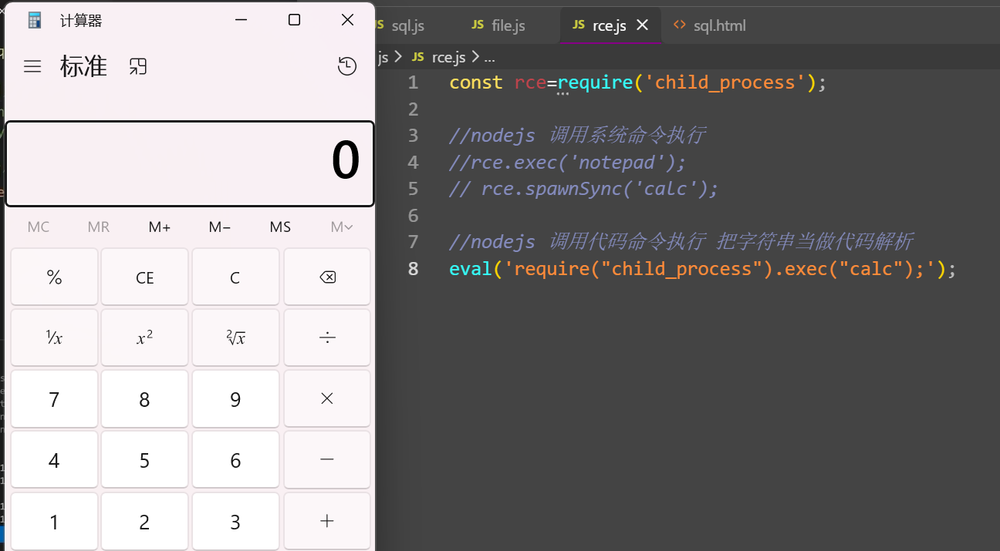
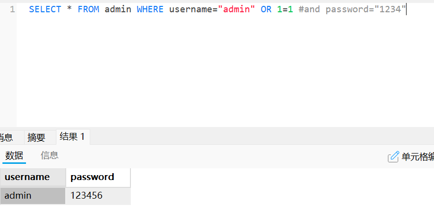
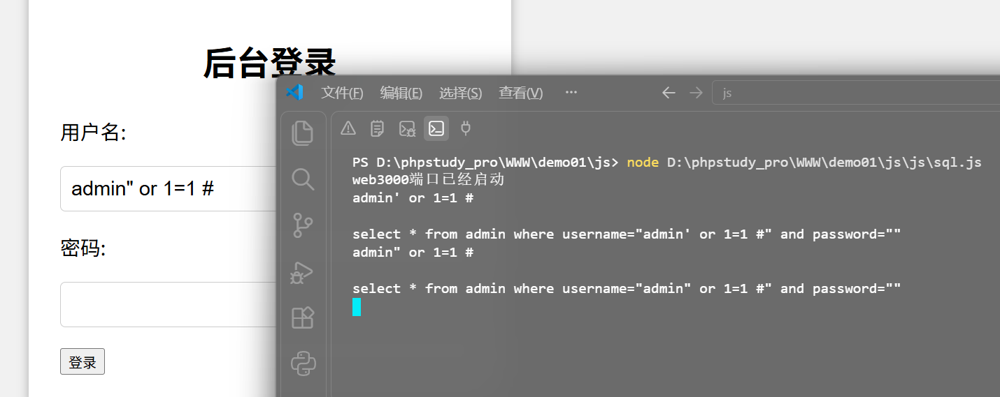
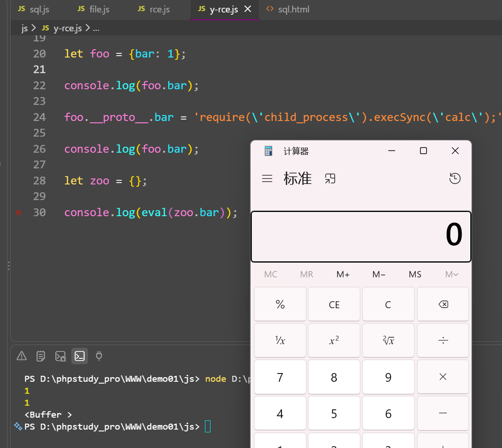

# NodeJS

文档[参考](https://www.w3cschool.cn/nodejs/)  node.js[安装](https://nodejs.org/en)

- **常用第三方库安装** (`npm i 库名`)：
  - `express`：轻量级 Web 应用框架。
  - `body-parser`：处理 POST 请求的 JSON、Raw、Text、URL 编码数据。
  - `cookie-parser`：解析 Cookie 的工具。
  - `multer`：处理 `enctype="multipart/form-data"`（文件上传）。
  - `mysql`：连接 MySQL 数据库的库。

## 功能实现

### 1.登录操作
 **前端页面交互与表单提交**
- **GET 请求接收参数**：使用 `req.query.参数名`。
- **POST 请求接收参数**：
  - 需先引入并配置 `body-parser` 中间件。
  - 使用 `req.body.参数名` 接收数据（支持 JSON、URL 编码等格式）。
- **页面渲染**：使用 `res.sendFile(__dirname + '/login.html')` 渲染本地 HTML 文件



```js
const express = require('express');
const app = express();

// 路由：接收 GET 请求
app.get('/login', function(req, res) {
    // req: 请求对象（获取参数）
    // res: 响应对象（返回结果）
    res.send('登录页面');
});
//在当前目录下，渲染sql.html文件
app.get('/',function(req,res) {
    res.sendFile(__dirname+'/'+'sql.html');
});

// 启动服务器
app.listen(3000, function() {
    console.log('Web 3000端口已启动');
});
```

post表单提交代码

```js
const bodyParser = require('body-parser')
var urlencodedParser = bodyParser.urlencoded({ extended: false })
app.post('/login',urlencodedParser,function(req,res){
    const u =req.body.username;
    const p = req.body.password;
    console.log(u);
    console.log(p);
    if(u == 'admin' && p == '123456'){
        res.send('欢迎进入后台');
    }else{
        res.send('登录用户或密码错误');
    }
})
```

### 2.加入数据库操作

核心代码

```js
const mysql = require('mysql');
app.post('/login',urlencodedParser,function(req,res){
    const u =req.body.username;
    const p = req.body.password;
    console.log(u);
    console.log(p);
    var connection = mysql.createConnection({
    host     : 'localhost',
    user     : 'root',
    password : 'root',
    database : 'demo'
    });
    connection.connect();
    const sql = 'select * from admin where username="'+u+'" and password="'+p+'"';
    connection.query(sql,function(error,data){
        if(error){
            console.log('数据库链接失败')
        }
        try {

            if(u==(data[0]['username']) && p==data[0]['password']) {

                res.send('欢迎进入后台管理页面')
            }
        } catch {
            res.send('错误')
        }

    })
})
```






### 3.文件管理

```js
const fs=require('fs');
const express = require('express');
const app = express();

app.get('/file', function (req, res) {
    const dir=req.query.dir;
    console.log(dir);
    filemanage(dir);
})

var server = app.listen(3000, function () {
    console.log('web应用3000端口已启动!')
})

function filemanage(dir){
    fs.readdir(dir,function(error,files){
        console.log(files);
})};
```



### 4.命令执行

```js
const rce=require('child_process');

//nodejs 调用系统命令执行
//rce.exec('notepad');
//rce.spawnSync('calc');

//nodejs 调用代码命令执行 把字符串当做代码解析
eval('require("child_process").exec("calc");');
```



## Nodejs常见安全问题

> [!NOTE]
>
> 实战测试NodeJS安全：
> 判断：参考前期的信息收集
> 黑盒：通过对各种功能和参数进行payload测试
> 白盒：通过对代码中写法安全进行审计分析

### 1.SQL注入&文件操作



尝试sql注入，由于判断语句接受的是值，所以进入不了后台页面


### 2.RCE执行&原型链污染

#### 原型链污染核心概念

在 JavaScript 中，对象通过原型机制进行继承。如果攻击者能够控制并修改对象的原型（`__proto__`），该修改将作用于**所有与该对象同类或继承自同一父类的对象**。

```js
// foo是一个简单的JavaScript对象
let foo = {bar: 1} //1=1 0 __proto__= x
// 原型链污染
// foo.bar 此时为1
console.log(foo.bar)

// 修改foo的原型（即Object）
foo.__proto__.bar = 'x'

// // 由于查找顺序的原因，foo.bar仍然是1
console.log(foo.bar)

// 此时再用Object创建一个空的zoo对象
let zoo = {}

// 查看zoo.bar，此时bar为2
console.log(zoo.bar)
```




>CTFSHOW几个题目
> [Web334-344](https://ctf.show/)
>https://f1veseven.github.io/2022/04/03/ctf-nodejs-zhi-yi-xie-xiao-zhi-shi/
>YApi管理平台[漏洞](https://blog.csdn.net/weixin_42353842/article/details/127960229)
>开发指南-NodeJS-安全SecGuide[项目](https://github.com/Tencent/secguide)
