 # 业务资产

[平台](https://forum.ywhack.com/bountytips.php?tools)

## 应用类型分类

1.`WEB`应用

2.`APP`应用

3.`PC`端应用

4.小程序应用

5.微信公众号

6.其他产品等

### 目标需求

```text
- 已知目标：IP地址、公司名、网址、企业名、单位名、学校名,都有可能
- 目标规模：大型目标（企业/学校）、单点目标（IP/网址）
```

常用小蓝本，爱企查等。最常用就这两个

这里用[小蓝本](https://www.xiaolanben.com/)演示一下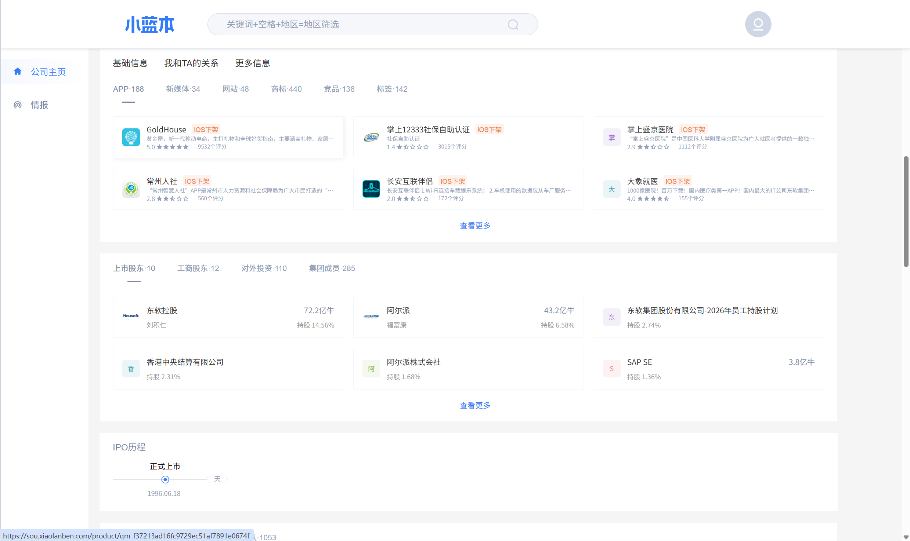

主要看旗下的网址域名还有常见的邮箱地址。看这个企业还有app，app和这个网站可能是分开的，里面可能有核心业务的需求，都可以呀尝试一下，微信公众号也是。可能有相应的接口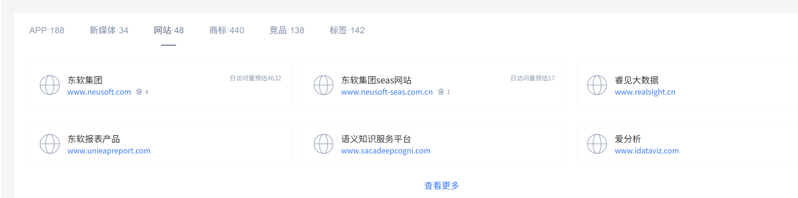

因此，企业的资产主要就分五类，可能情况如下：

```
- 网站应用（宣传展示）
- APP应用（核心业务）
- PC端应用（实际产品）
- 小程序应用（特定服务）
- 微信公众号（接口、服务对接）
```

主要就是看app，新媒体，网址还有就是查询方向，这个企业可能有子公司。最后查出来再把它归类一下是哪个方向，具体流程：

```text
已知信息 --> 小蓝本爱企查 --> 看企业资产域名子公司 --> 确定核心业务归类（APPA应用，网站应用 pc应用小程序之类的）    
```

# `web` 应用


## 域名

分文单域名和子域名两种

### `web`单域名

单域名获取

```text
- 备案信息查询（官方备案管理系统，需通过备案号查询）
- 企业产权查询（通过爱企查等平台获取域名）
- 注册域名查询（通过腾讯云等平台查询相似域名，寻找未投入使用或防御性注册的域名）
```

#### 备案信息查询子公司

主要通过查询 [备案查询网站](https://beian.miit.gov.cn)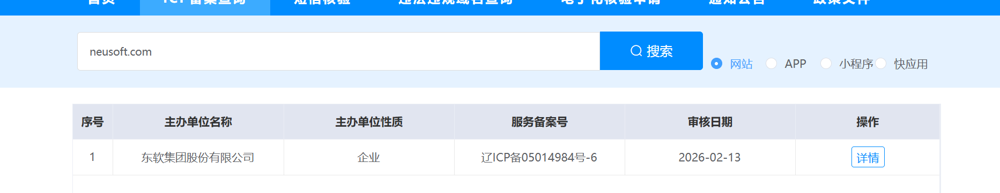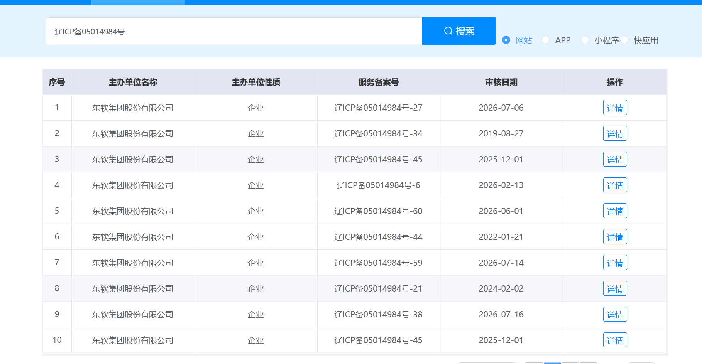

#### 企业产权查询

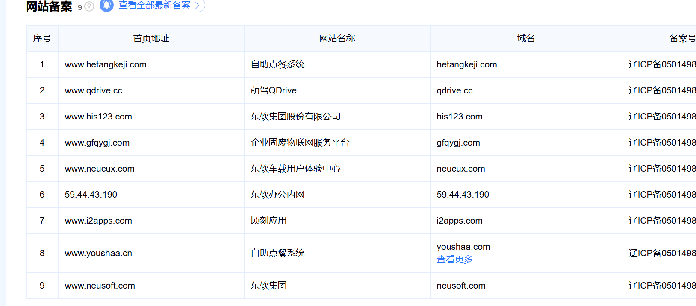

#### 注册域名查询

从注册域名的[网站](https://buy.cloud.tencent.com/domain)查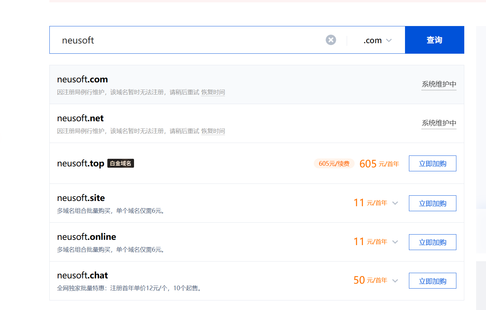

可以看被注册的域名可能是这个公司的其他相关网站

#### `ip`反查

通过ip反查域名，[网站](https://x.threatbook.com/)先获取一下ip地址

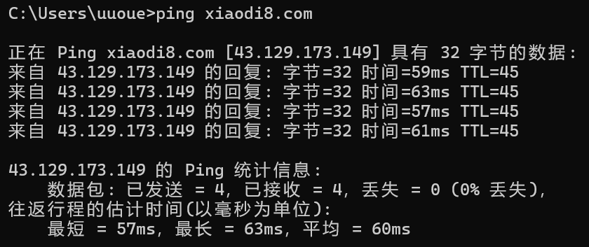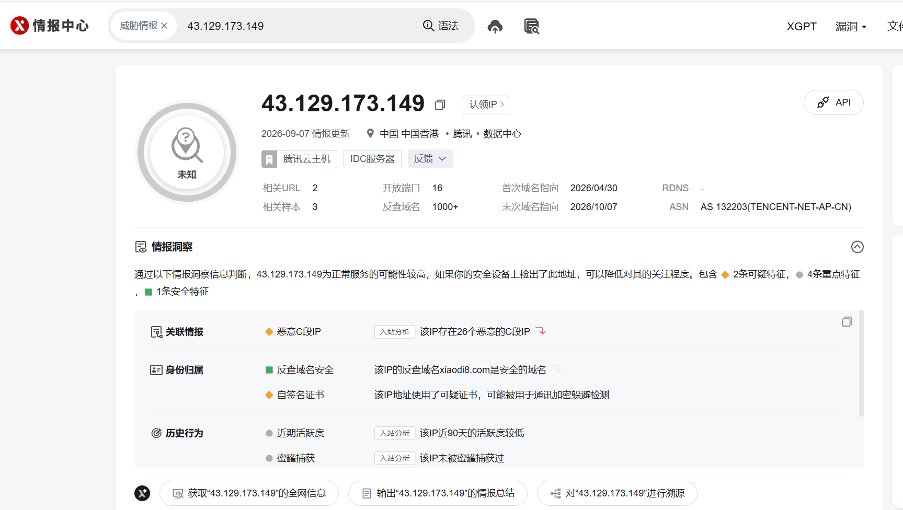

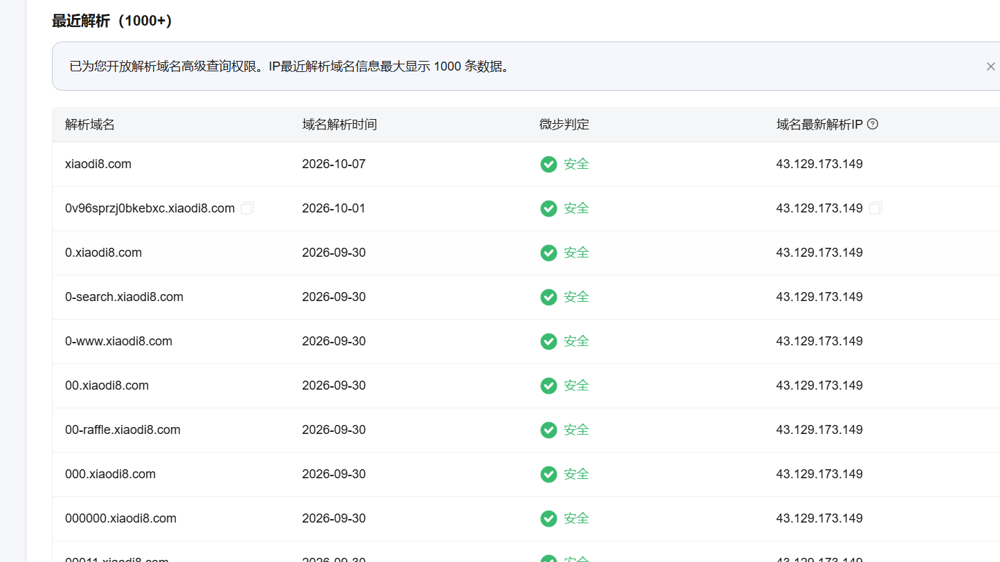

### `web`子域名

获取方式主要五种

```text
- 方法一：DNS数据查询
  - 原理：查询历史DNS解析记录
  - 工具：DNS查询平台（如DNSdumpster等）
  - 作用：查找历史解析IP，辅助寻找CDN背后的真实IP
- 方法二：证书查询（SSL/TLS证书）
  - 原理：利用HTTPS证书的关联性
  - 工具：证书查询平台（如Censys、FOFA等）
  - 作用：查找使用同一证书的域名
- 方法三：网络空间搜索引擎
  - 常用平台：FOFA、Quake、Hunter、ZoomEye、Shodan
  - 作用：通过语法搜索，快速定位目标资产、开放端口、服务等
- 方法四：威胁情报平台
  - 常用平台：微步在线、奇安信威胁情报中心、360威胁情报中心
  - 作用：查询域名解析、关联域名、历史情报
- 方法五：字典枚举（暴力破解）
  - 原理：利用字典批量拼接前缀进行DNS解析
  - 工具：Layer子域名挖掘机、SubDomainsBrute、OneForAll
  - 说明：OneForAll集成了前三种技术（字典、证书、DNS记录），使用最广
```

#### [`DNS`数据查询](https://dnsdumpster.com/) 

可以查找历史解析的ip，帮助寻找[CDN](Web架构_OSS存储_负载均衡_CDN加速_反向代理_WAF防护#CDN )背后的真实ip

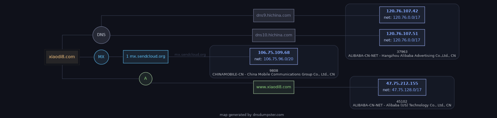

此公司极大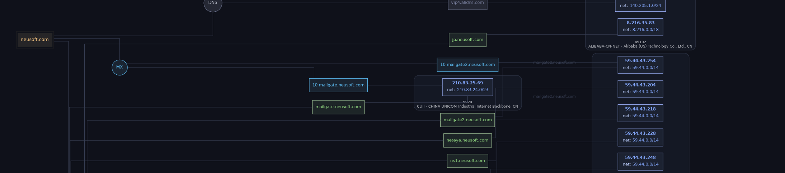

#### [证书查询](https://crt.sh/)

就是https证书仅限于有https的才行。可以查找使用同一证书的域名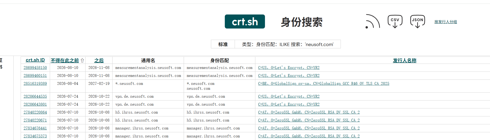

#### 网络空间搜索引擎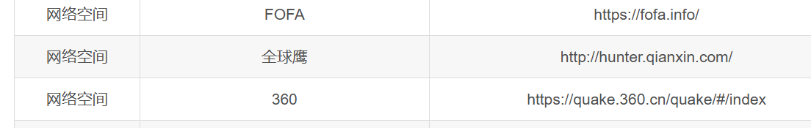

可以快速定位信息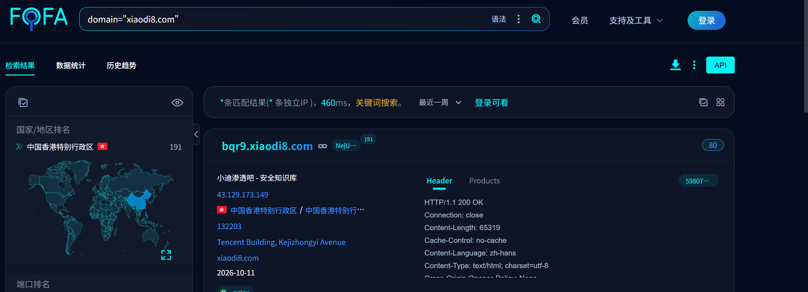

#### 威胁情报平台

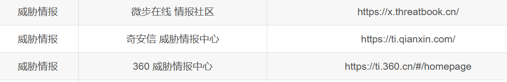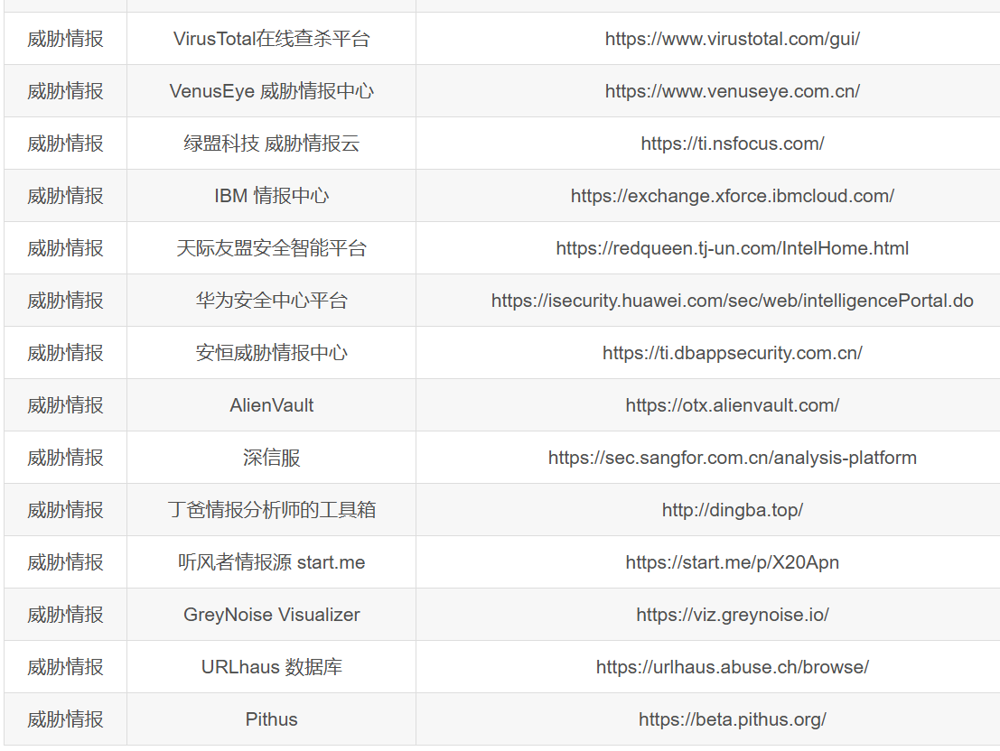

<u>可以查询其关联域名</u>

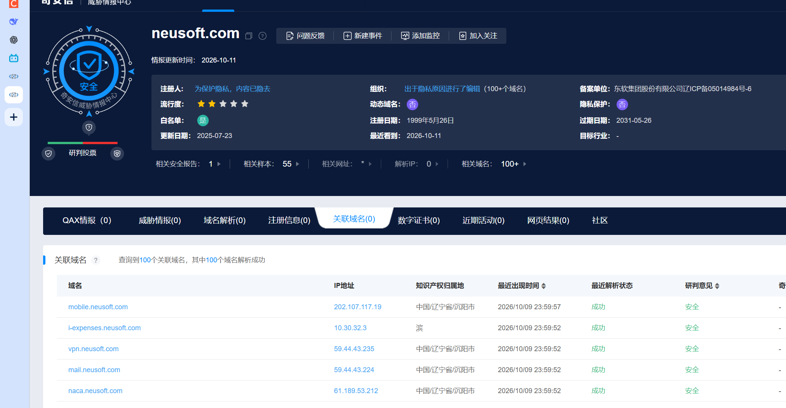

#### 字典枚举（暴力破解）

利用字典批量拼接前缀进行DNS解析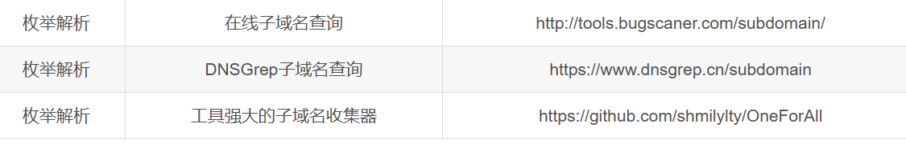

最强大的工具 [OneForAll]( https://github.com/shmilylty/oneforall)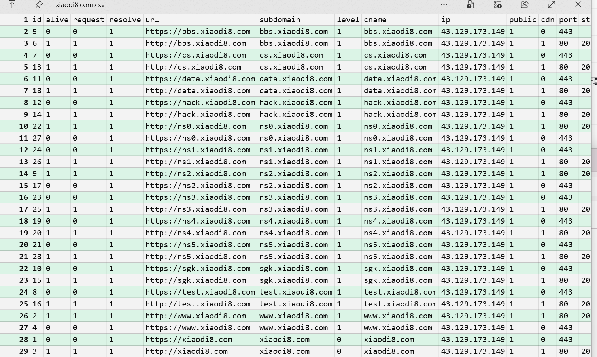

## `web` 架构

```text
- 程序语言（PHP、Java、Python、ASP等）
- 程序源码（CMS系统，如JBlog、WordPress等）
- 中间件（Apache、Nginx、IIS、Tomcat等）
- 数据库（MySQL、MSSQL、Oracle等）
- 操作系统（Windows、Linux等）
- 是否使用CDN（内容分发网络）
```

### 指纹识别工具

[指纹识别](https://fp.shuziguanxing.com/#/)

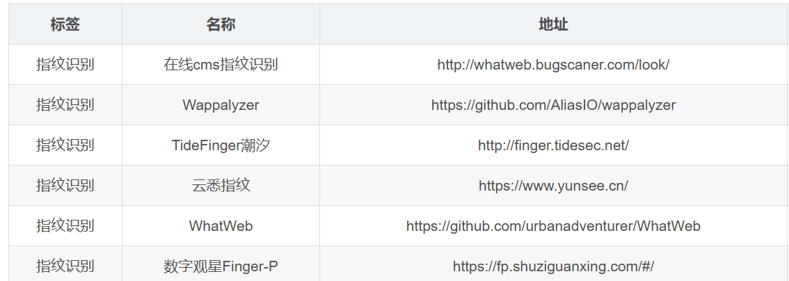

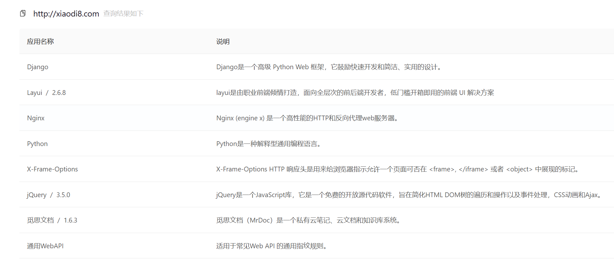

可了解网站的cms

----


## 源码获取（web架构深入）

测试中分为黑盒测试和白盒测试，黑盒就是无源码，白盒就是有源码。对代码能力要求比较高。

### 开源源码

开源的可以从官网下载，`GitHub`源码站下载。

可以通过指纹识别平台获取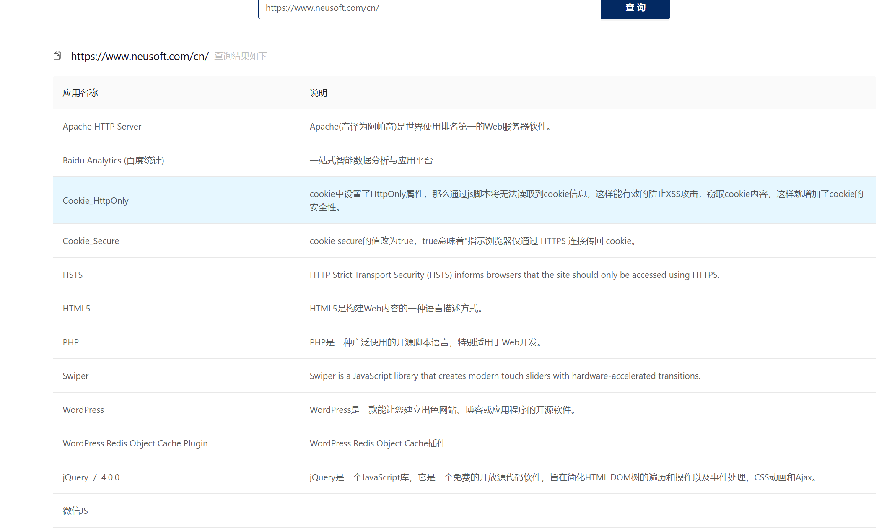

上图`CSM`为`WordPress` ，为源码下载下来就可

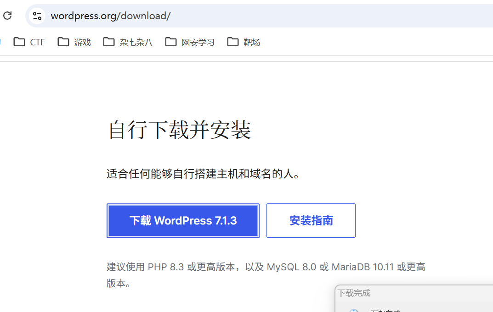

下载下来的文件本地进行搭建进行审计。后续

### 闭源源码

有的无法找到`CMS`  可通过特殊方法

#### [备份文件泄露](https://www.secpulse.com/archives/124398.html)

根据管理员备份习惯，从备份文件中获取信息

##### 网站备份文件

- 管理员将网站源码打包成 `.zip`、`.rar`、`.tar.gz`、`.war` 等，放在网站目录下。
- 常见命名：`www.zip`、`wwwroot.zip`、`域名.zip`、`backup.zip` 等。
- 用目录扫描工具（如御剑、`dirsearch` 等）扫描敏感文件即可发现并下载。
- 下载后可能直接得到完整源码、数据库配置文件等。

##### `Git`源码泄露

- 开发时使用 `Git `版本控制，会在项目目录下生成 `.git` 文件夹。
- 上线后未删除 `.git`，导致可通过工具还原源码。
- 判断方式：访问 `http://目标/.git/`，返回 403 说明存在，404 说明不存在。
- 利用工具：`GitHack` 等，可还原部分或全部源码。

##### `SYN源码`泄露

- 与 Git 类似，SVN 也会在项目目录下生成 `.svn` 文件夹。
- 判断方式：访问 `http://目标/.svn/`。
- 利用工具：`svnExploit`、`Seay-SVN` 等。
- 注意：部分工具是 `Python 2 `编写，需用 `Python 2` 运行；必要时安装依赖库。
- 下载后可查看源码文件，部分源码可能被加密（如` PHP` 加密），需进一步解密分析。

##### `BS_Store`泄露

- macOS 系统在文件夹下会自动生成 `.DS_Store` 文件，记录目录结构和文件信息。
- 若开发者用 Mac 开发并上传服务器时未删除，可能导致目录结构泄露。
- 判断方式：访问 `http://目标/.DS_Store`，可下载。
- 利用工具：`ds_store_exp` 等，可还原目录结构。
- 注意：`DS_Store` 主要泄露目录结构，不一定能还原完整源码。

##### `composer.json`泄露

- PHP 项目使用` Composer` 管理依赖，会生成 `composer.json`、`composer.lock` 等文件。
- 若未删除，可能泄露依赖包、版本、接口信息等。
- 判断方式：访问 `http://目标/composer.json`。
- 可结合已知漏洞版本进行进一步利用。

> 其他较少见的泄露：`.bzr`、`.swp`、`.hg` 等，遇到再查即可。

#### 代码托管平台搜索

当无法识别程序，或识别出但下载不到时，可通过程序员常用的代码托管/交流平台搜索特征信息。

##### 常用平台

- `GitHub`（国外）
- `Gitee`（国内）
- `OSChina`（国内）
- `CSDN`、`CNBlog `等（非专业程序员社区，但也可尝试）

##### 搜索方式

1. **特征文件搜索**
   - 从目标网站抓包或目录扫描中，选取**固定存在的脚本文件、`JS` 文件**（不要选图片、上传文件）。
   - 用文件名、路径、特有字符串在` GitHub`/`Gitee` 搜索。
   - 示例：搜索 `jblog.php`、`jblog.js`、`JBlog Team` 等。
   - 找到相关项目后，可进一步找到官网或源码下载地址。
2. **关键字搜索**
   - 搜索源码中遗留的 QQ 邮箱、作者名、版权信息、注释等。
   - 这些信息可能在目录扫描工具（如 Burp、AWVS）爬行时被发现。
   - 示例：搜索 `qq.com`、`@author`、`版权` 等。
3. **个人搜索**
   - 搜索开发者/作者的个人信息，如 ID、邮箱、博客、GitHub 主页等。
   - 若找到作者，可能顺藤摸瓜找到其开源或分享的源码。

> 注意：搜索时要确认域名对应，避免搜到第三方接口或 CDN 资源。


###  黑灰产行业源码获取

- 黑灰产（如博彩、棋牌、传销币、色情等）通常使用**专门开发的源码**，不会在常规源码站上架。
- 获取方式：
  - 在专门的黑灰产源码交易平台、论坛、社群中寻找；
  - 用谷歌/国外搜索引擎搜索特定关键字（如“棋牌源码”、“交易所源码”、“跑分源码”等）；
  - 需要平时收集和积累相关资源。
- 特点：
  - 源码多为闭源、收费、小范围流传；
  - 大型黑灰产团队会自研，源码不会外流；
  - 小型黑灰产可能购买廉价源码，安全性差，可能存在后门。

> 此类源码获取与常规指纹识别、官网下载无关，属于特殊行业方向。

---


## 前端JS打点

本节课重点：从 JS 文件中提取更多 URL/接口地址、敏感信息，发现更多 JS 文件，为后续 JS 渗透测试打基础。

### 前端后端源码对比


| 对比项       | 后端源码                                   | 前端源码                   |
| ------------ | ------------------------------------------ | -------------------------- |
| 浏览器可见性 | 看不见真实源代码                           | 浏览器可以看见真实源代码   |
| 获取方式     | [指纹识别，源码泄露，代码托管](#源码获取 ) | 直接查看，抓包以及工具提取 |
| 核心逻辑     | 在服务器端                                 | 浏览器端可以直接分析       |
| 安全测试     | 黑盒/白盒                                  | 直接对源码分析             |

> [!CAUTION]
>
> 两者可以混用，PHP 写界面 + JS 传数据，或 JS 写界面 + PHP 传数据。不是说用 JS 开发就不安全，也不是说后端源码泄露就不安全，只是两种不同的开发模型。怎么选择重点看环境

### 判断是否为JS

1. 直接插件判断就可以，下图就是经典js框架项目

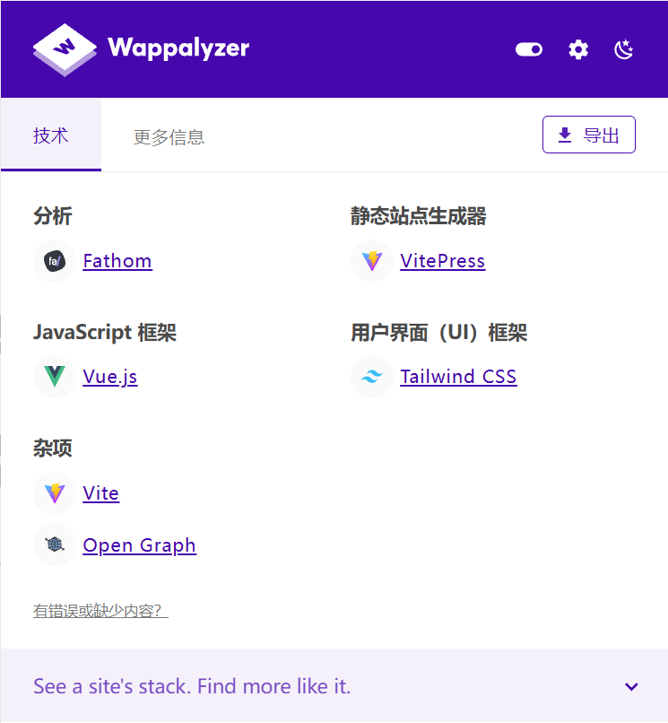

2. 有大量js文件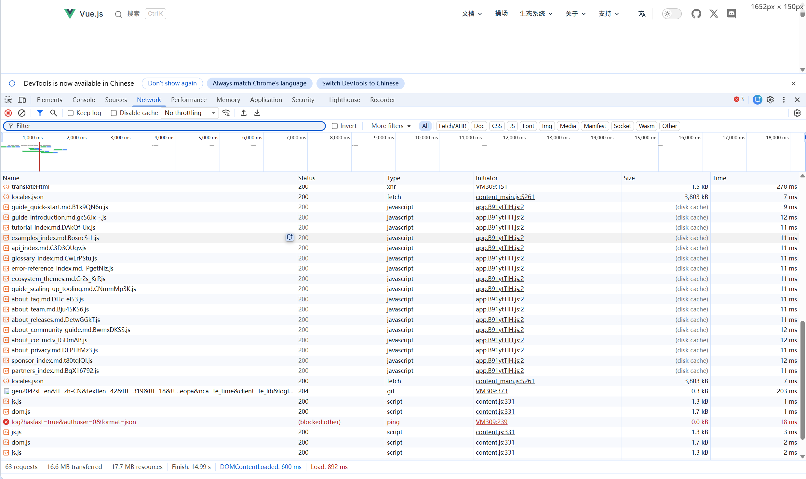

可以直接看见代码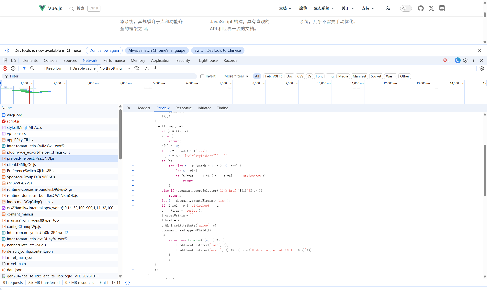

3. 一般有/`static`/`js`/`app.js`等顺序的`js`文件

4. 一般cookie中有`connect.sid`
### 测试方式
js会造成很多安全问题，源码泄漏，比如未授权访问=JS里面分析更多的URL访问确定接口路径，敏感key泄漏=JS文件中可能配置了接口信息（云应用，短信，邮件，数据库等），API接口安全=（代码中加密提交参数传递，更多的URL路径）。我们有三种方式获得js文件
1. 手工
  通过网页浏览器`F12`进行抓包，主要是搜索如下信息

  | `src=`                    | 加载外部资源       | 发现 JS 文件、图片、内嵌页面路径 |
  | ------------------------- | ------------------ | -------------------------------- |
  | `path=`                   | 指定路由/接口路径  | 发现隐藏路由、接口路径           |
  | `method:"get"`            | 指定 GET 请求      | 明确请求方式，方便直接访问测试   |
  | `method:"post"`           | 指定 POST 请求     | 明确请求方式，方便重放测试       |
  | `http.get("`              | 发起 GET 请求      | 暴露请求 URL                     |
  | `http.post("`             | 发起 POST 请求     | 暴露请求 URL                     |
  | `$.ajax`                  | jQuery Ajax 请求   | 快速找到所有接口调用             |
  | `http://service.httppost` | 特定服务 POST 接口 | 发现内部服务接口                 |
  | `http://service.httpget`  | 特定服务 GET 接口  | 发现内部服务接口                 |

  

2. 半自动-burp suite插件

   ```
   官方插件：
   - JS Miner：从 JS 中提取敏感信息。
   - JS Link Finder：提取 JS 中的链接。
   第三方：
   - HRE (HTTP Request Editor)：标记请求包中的敏感信息（JS 接口、特殊信息）。
   - ULED：筛选相关数据，快速定位关键数据包。
   ```

   

   下载[HRE插件](https://github.com/overspace-labs/HaENet) 查了一下，现在只能用构架[Grsdle](https://gradle.org/) 打包了。

   通过插进可以快速识别出js文件中暴露的信息，邮箱号码等

   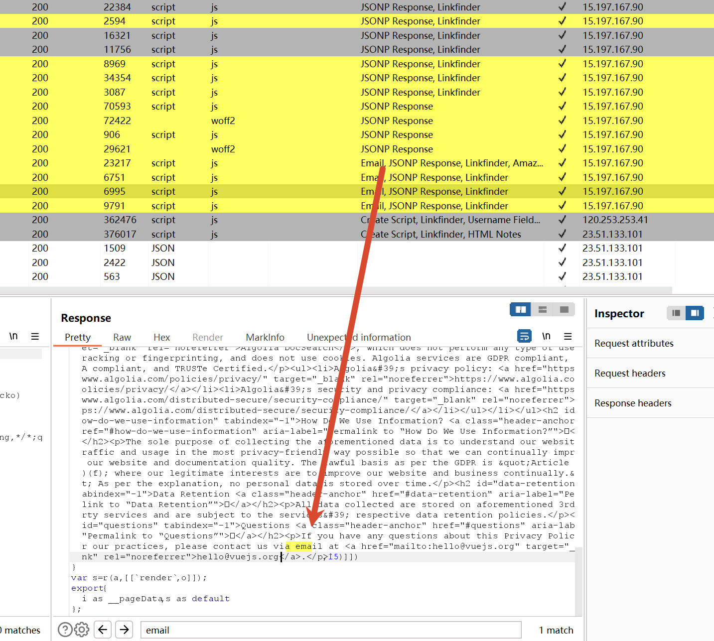

   > [!NOTE]
   >
   > 规则可以自己配置，根据上色的信息查找，一步步分析验证，最后判断仍然需要人工。

3. 工具化-各类提取项目

   ```
   - FindSomthing 浏览器插件，不演示了，功能很强
   - JSFinder，
   - URLFinder
   ```

   > `JSFinder`

   试了一下基本全失败了，不知道为什么，有空再查

   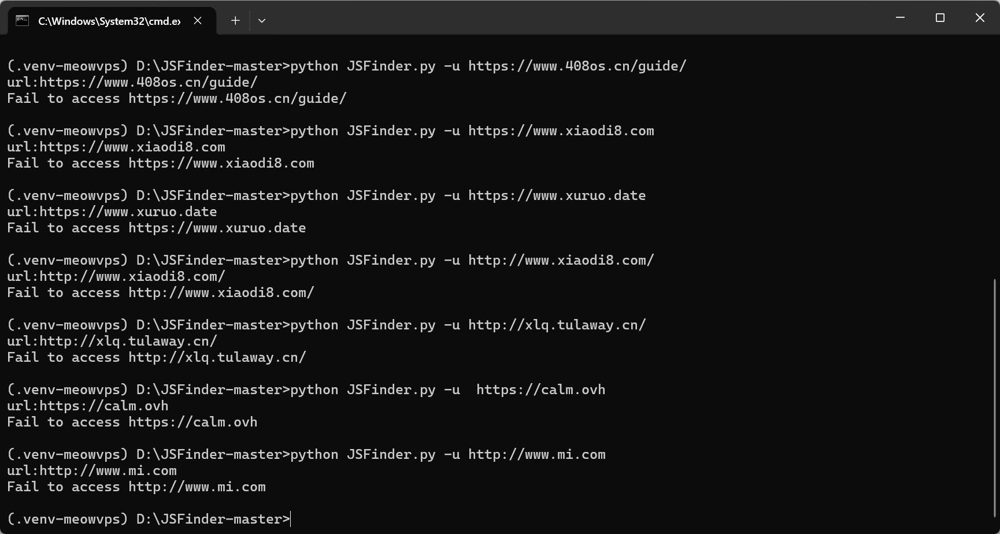

   解决了，终端代理的问题，把代理取消就可以了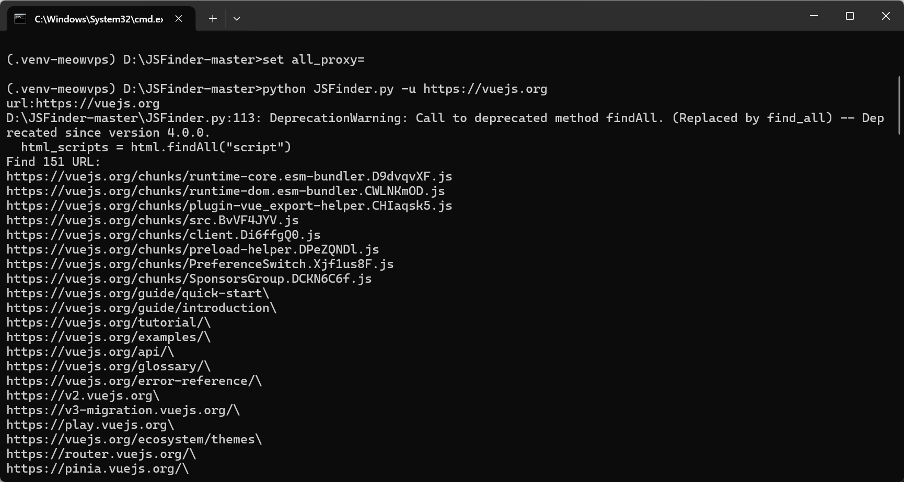

   > `URLFinder`,[链接](https://github.com/pingc0y/URLFinder)
   
   也是注意终端代理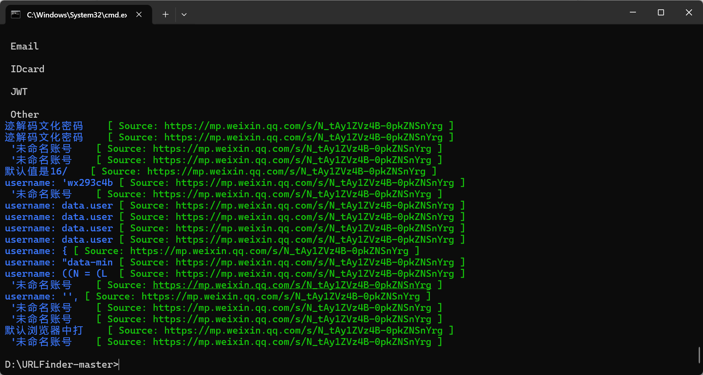

> `ffuf` 强大的[fuzz](https://github.com/ffuf/ffuf)测试模型

这里提供一个字典下载[站点](https://wordlists.assetnote.io/),提供常见文件名。有些js我们无法看见，它可能隐藏需要登录后才能看见，此时我们需要强制爆破的形式。

根据使用文档输入命令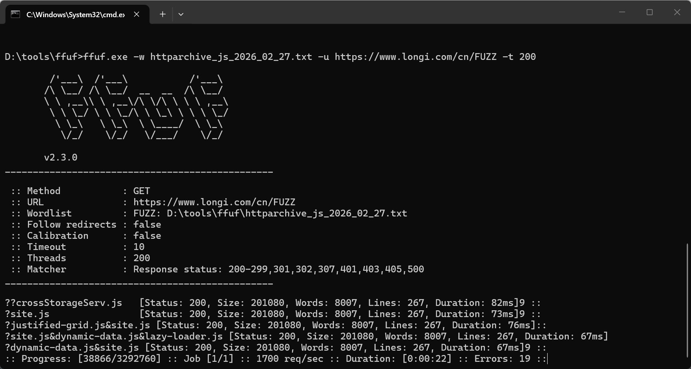

网站和工具对比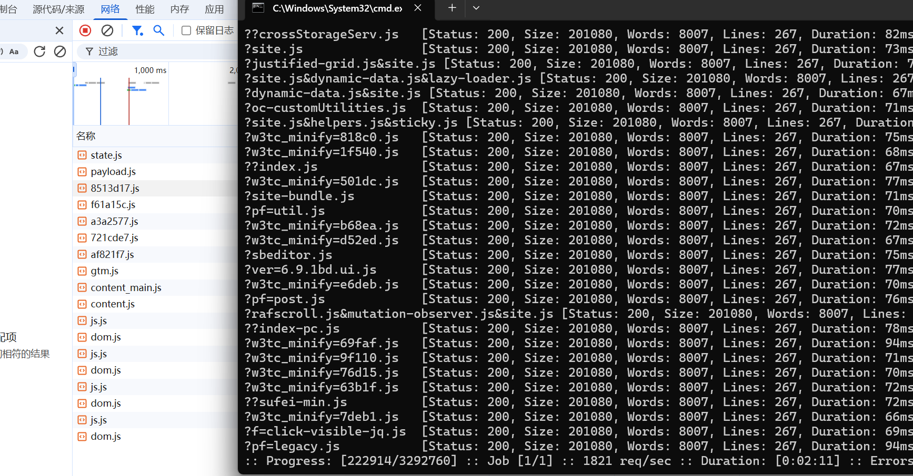

> `packer-Fuzzer` 针对`Wepack` 等前端打包工具构造的网站 进行快速安全检测的[扫描工具](https://github.com/rtcatc/Packer-Fuzzer)

杂项窗口就是打包工具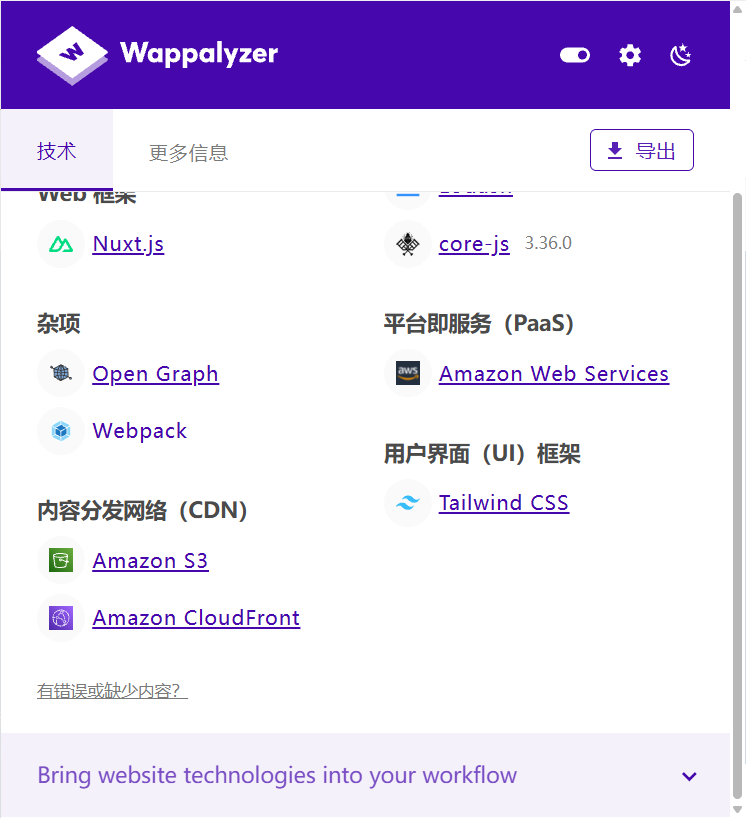

python项目我打算创建虚拟环境运行

```python
py -3 -m venv .venv # 在项目下面创造环境
.venv\Scripts\Activate. #激活环境
python -m pip install -r requirements.txt #一般目录地下会有这个文件，根据这个文件安装所需要的库就可以，没有的话根据报错安装就行
```

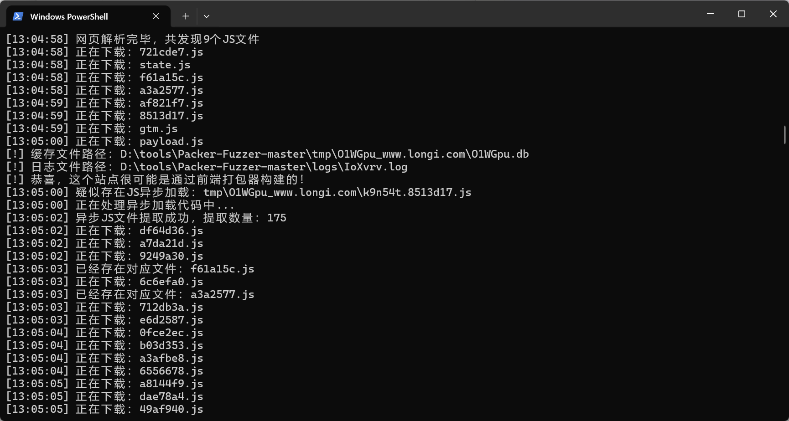

> 前面的工具是提取页面里显示出的js,而后两种是强行爆破

----

## 主机架构分析

> 本节课核心：围绕 Web 架构下面的“主机架构”部分，讲三个技术点——**端口识别、WAF识别、蜜罐识别**。
> 对应架构信息：Web服务器、应用服务器、数据库类型、操作系统、FTP/SSH等服务、WAF、蜜罐。

### web服务器&应用服务器

1. web服务器

- 常见：Apache、Nginx、IIS

- 识别方式：**看 HTTP 响应包中的 `Server` 字段**
  - 访问网站 → 抓包 → 看 Response Headers 里的 `Server: Apache`
  
- 作用：判断网站用什么 Web 服务器

2. 应用服务器

- 常见：Tomcat、JBoss、WebLogic、WebSphere
- 特点：**和 Java 应用强相关**，默认会开放特定端口
  - Tomcat 默认 8080
  - JBoss 默认 8080
  - WebLogic 默认 7001
  - AJP 协议 8009
- 识别方式：**端口扫描**（因为响应包里可能看不到）

> 两者都可统称“中间件”，但应用服务器有明显端口特征，需通过端口扫描识别。

3.端口扫描技术

（1）[nmap](https://nmap.org/)

具体教程看这篇博客 : [地址](https://blog.csdn.net/qq_53079406/article/details/125263917)

正常我们是看不到网站的应用服务的，只能看见web服务。用扫描工具可以看见。可以根据扫描结果看哪个端口开没开，open就是开了，closed就是关上了， filter就是可能开可能关，通常是因为某个应用服务需要这个端口让防火墙打开了，但是受到防火墙保护，一般不能访问。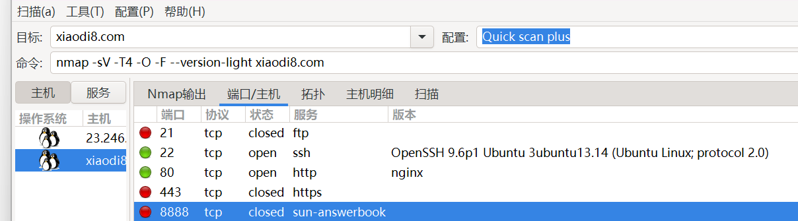

注意了，端口开不一定代表可以打开，必须是http/https协议的才可以访问，其他协议不可以。比如我访问这个22端口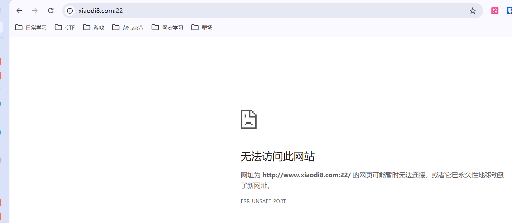

<u>还有我的vps433端口，哪怕显示400我也可以看到</u>

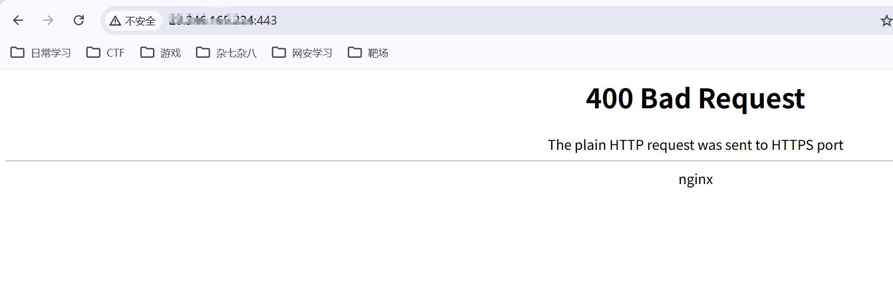

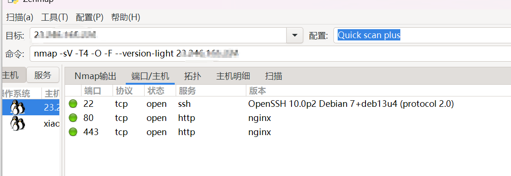

(2)[mascan](https://github.com/robertdavidgraham/masscan)

[教程](https://blog.csdn.net/qq_53079406/article/details/125266331)

`masscan.exe -p 端口号 ip地址` 可以检查某端口是否开放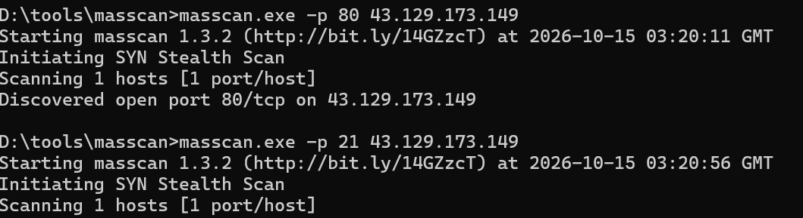

也可以多个端口一起测试

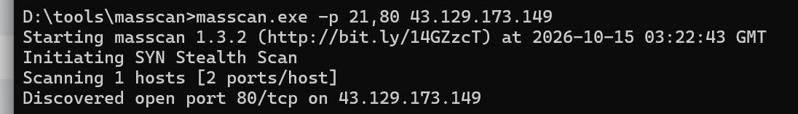

(3) [网络空间直接测试](#网络空间搜索引擎)

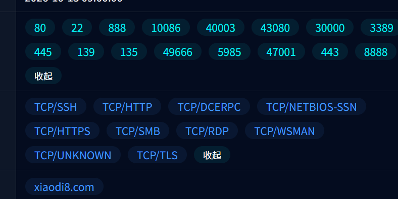

> [!CAUTION]
>
> 考虑防火墙和内网环境的因素。
>
> 内网环境可能出现的情况：目标数据库端口开放，网站也能正常打卡，但是攻击者扫描目标端口却发现端口没有开放（排除防火墙问题）.这是因为目标数据库在内网环境的主机下，它通过反向代理将端口映射到外网ip，攻击者扫描外围ip只能扫出来映射的端口，内网真实服务器端口扫不到。

| **端口**                          | **服务**              | **渗透用途**                                                 |
| --------------------------------- | --------------------- | ------------------------------------------------------------ |
| tcp 20,21                         | FTP                   | 允许匿名的上传下载,爆破,嗅探,win提权,远程执行(proftpd  1.3.5),各类后门(proftpd,vsftp 2.3.4) |
| tcp 22                            | SSH                   | 可根据已搜集到的信息尝试爆破,v1版本可中间人,ssh隧道及内网代理转发,文件传输等等 |
| tcp 23                            | Telnet                | 爆破,嗅探,一般常用于路由,交换登陆,可尝试弱口令               |
| tcp 25                            | SMTP                  | 邮件伪造,vrfy/expn查询邮件用户信息,可使用smtp-user-enum工具来自动跑 |
| tcp/udp 53                        | DNS                   | 允许区域传送,dns劫持,缓存投毒,欺骗以及各种基于dns隧道的远控  |
| tcp/udp 69                        | TFTP                  | 尝试下载目标及其的各类重要配置文件                           |
| tcp 80-89,443,8440-8450,8080-8089 | 各种常用的Web服务端口 | 可尝试经典的topn,vpn,owa,webmail,目标oa,各类Java控制台,各类服务器Web管理面板,各类Web中间件漏洞利用,各类Web框架漏洞利用等等…… |
| tcp 110                           | POP3                  | 可尝试爆破,嗅探                                              |
| tcp 111,2049                      | NFS                   | 权限配置不当                                                 |
| tcp 137,139,445                   | Samba                 | 可尝试爆破以及smb自身的各种远程执行类漏洞利用,如,ms08-067,ms17-010,嗅探等…… |
| tcp 143                           | IMAP                  | 可尝试爆破                                                   |
| udp 161                           | SNMP                  | 爆破默认团队字符串,搜集目标内网信息                          |
| tcp 389                           | LDAP                  | ldap注入,允许匿名访问,弱口令                                 |
| tcp 512,513,514                   | Linux rexec           | 可爆破,rlogin登陆                                            |
| tcp 873                           | Rsync                 | 匿名访问,文件上传                                            |
| tcp 1194                          | OpenVPN               | 想办法钓VPN账号,进内网                                       |
| tcp 1352                          | Lotus                 | 弱口令,信息泄漏,爆破                                         |
| tcp 1433                          | SQL Server            | 注入,提权,sa弱口令,爆破                                      |
| tcp 1521                          | Oracle                | tns爆破,注入,弹shell…                                        |
| tcp 1500                          | ISPmanager            | 弱口令                                                       |
| tcp 1723                          | PPTP                  | 爆破,想办法钓VPN账号,进内网                                  |
| tcp 2082,2083                     | cPanel                | 弱口令                                                       |
| tcp 2181                          | ZooKeeper             | 未授权访问                                                   |
| tcp 2601,2604                     | Zebra                 | 默认密码zerbra                                               |
| tcp 3128                          | Squid                 | 弱口令                                                       |
| tcp 3312,3311                     | kangle                | 弱口令                                                       |
| tcp 3306                          | MySQL                 | 注入,提权,爆破                                               |
| tcp 3389                          | Windows rdp           | shift后门[需要03以下的系统],爆破,ms12-020                    |
| tcp 3690                          | SVN                   | svn泄露,未授权访问                                           |
| tcp 4848                          | GlassFish             | 弱口令                                                       |
| tcp 5000                          | Sybase/DB2            | 爆破,注入                                                    |
| tcp 5432                          | PostgreSQL            | 爆破,注入,弱口令                                             |
| tcp 5900,5901,5902                | VNC                   | 弱口令爆破                                                   |
| tcp 5984                          | CouchDB               | 未授权导致的任意指令执行                                     |
| tcp 6379                          | Redis                 | 可尝试未授权访问,弱口令爆破                                  |
| tcp 7001,7002                     | WebLogic              | Java反序列化,弱口令                                          |
| tcp 7778                          | Kloxo                 | 主机面板登录                                                 |
| tcp 8000                          | Ajenti                | 弱口令                                                       |
| tcp 8009                          | tomcat Ajp            | Tomcat-Ajp协议漏洞                                           |
| tcp 8443                          | Plesk                 | 弱口令                                                       |
| tcp 8069                          | Zabbix                | 远程执行,SQL注入                                             |
| tcp 8080-8089                     | Jenkins,JBoss         | 反序列化,控制台弱口令                                        |
| tcp 9080-9081,9090                | WebSphere             | Java反序列化/弱口令                                          |
| tcp 9200,9300                     | ElasticSearch         | 远程执行                                                     |
| tcp 11211                         | Memcached             | 未授权访问                                                   |
| tcp 27017,27018                   | MongoDB               | 爆破,未授权访问                                              |
| tcp 50070,50030                   | Hadoop                | 默认端口未授权访问                                           |

### WAF

`WAF`就是网站应用防火墙，保护web应用，防止攻击。实战碰见的话直接跑路就完了。


| 类型 | 说明 | 常见产品 |
|---|---|---|
| **云 WAF** | 云厂商提供，购买即用 | 腾讯云、阿里云、华为云、百度云、AWS |
| **硬件 WAF** | 安全公司硬件设备，部署在机房 | 深信服、安恒、绿盟、永信至诚、四创 |
| **软件 WAF** | 自己下载安装到服务器 | 安全狗、D盾、宝塔 |
| **代码级 WAF** | 在代码里写过滤规则 | 代码中集成 |

识别方式

（1）人工识别

看拦截页面，根据拦截页面判断是哪种防火墙。**云 WAF / 硬件 WAF**：基本放弃，绕不过。**软件 WAF**（安全狗、宝塔等）：可以尝试绕过。**代码级 WAF**：可以尝试分析过滤规则。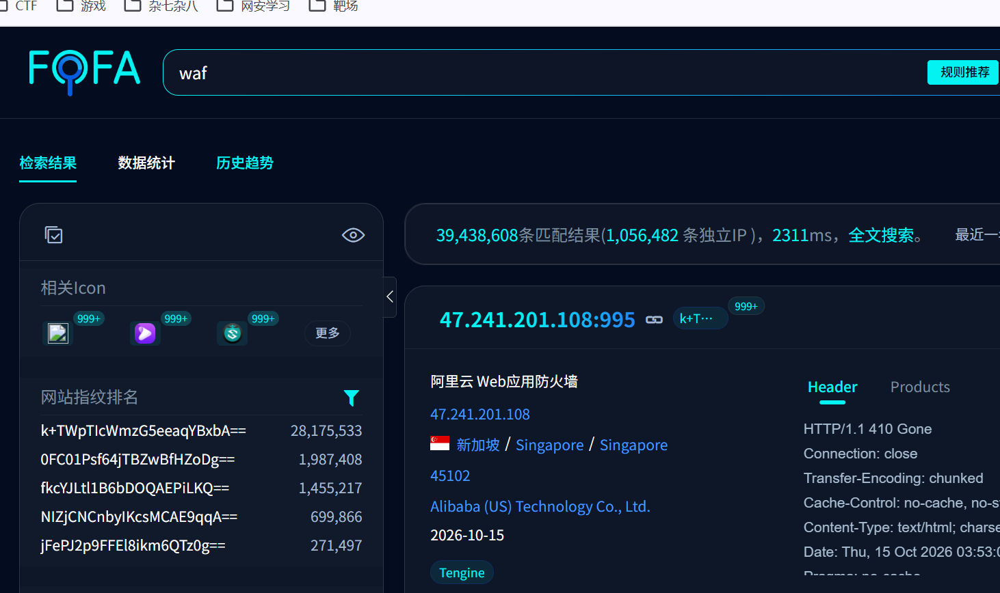

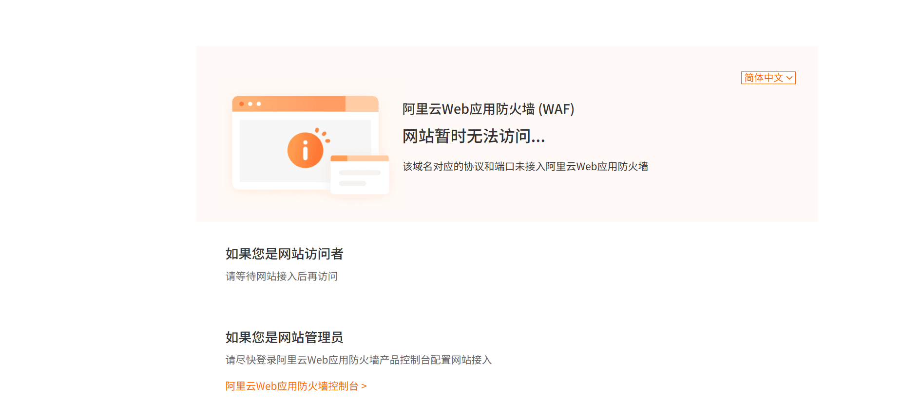


（2）工具识别

[wafw00f](https://github.com/EnableSecurity/wafw00f)

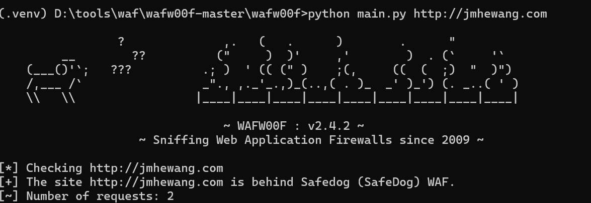

[identYwaf](https://github.com/stamparm/identYwaf)

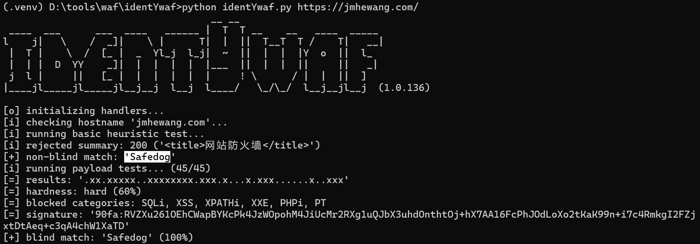

### 蜜罐


一种安全威胁检测技术，本质是**引诱和欺骗攻击者**。
- 蓝队用它：捕获红队攻击手段、记录攻击者信息、浪费攻击者时间
- 红队要学：**识别蜜罐，避免浪费时间**

分类

| 类型 | 交互程度 | 说明 |
|---|---|---|
| **低交互** | 简单 | 只记录基本攻击信息 |
| **中交互** | 玩一会儿 | 能模拟更多服务，记录更多信息 |
| **高交互** | 深入 | 模拟完整系统，长时间欺骗攻击者 |


蜜罐产品常见分类

- **Web 蜜罐**
- **数据库蜜罐**
- **物联网蜜罐**
- **工控蜜罐**
- **SSH 蜜罐**
- **FTP 蜜罐**
- **MSSQL 蜜罐**

> 常见蓝队蜜罐产品：HFish、MySQL蜜罐、SSH蜜罐等。

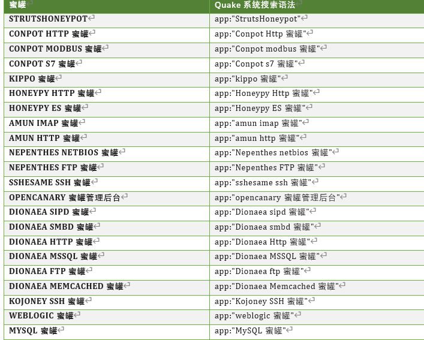

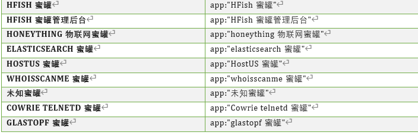

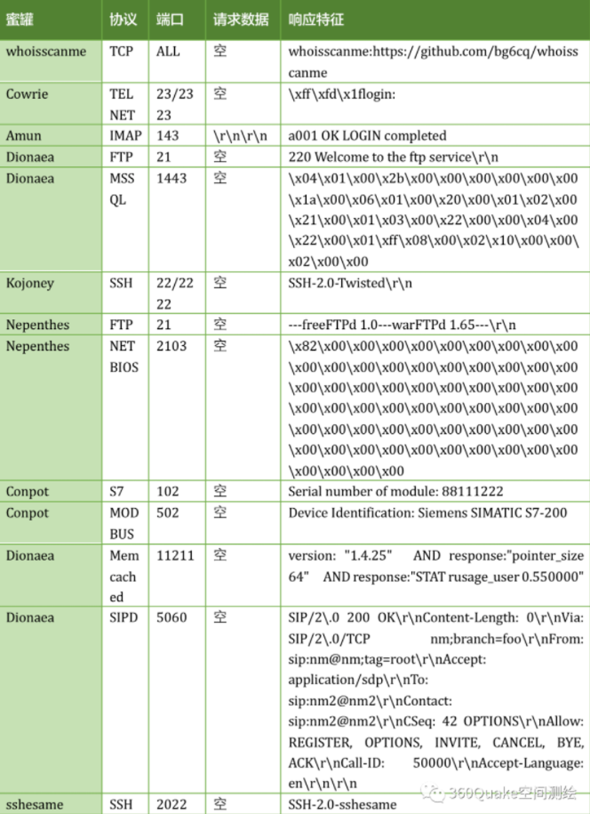

蜜罐识别

[原理](https://mp.weixin.qq.com/s/jPz9hBmUypFyQlU27vglUg)

1. 安装蜜罐

先在我vps上安装一下。把防火墙端口打开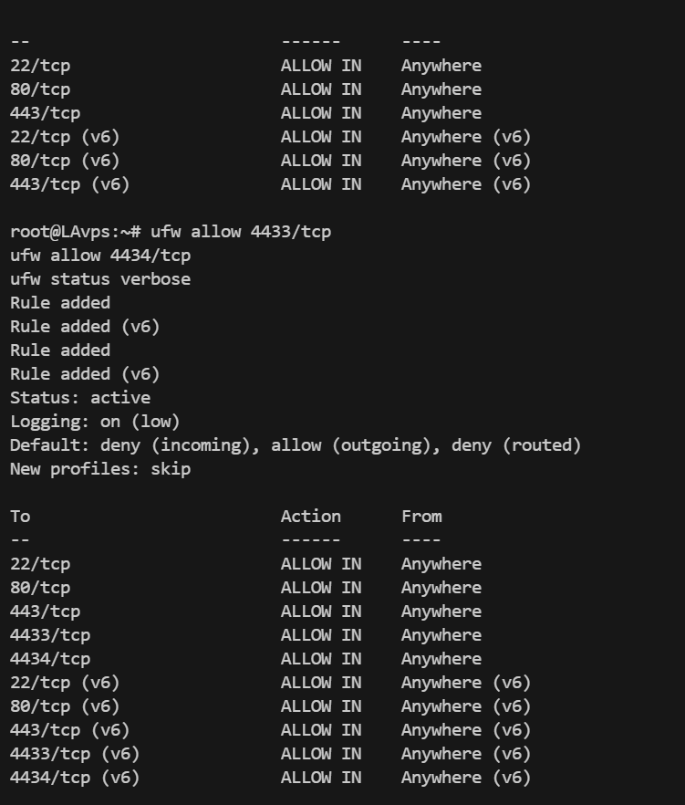

`bash <(curl -sS -L https://hfish.net/webinstall.sh)` 安装

竟然一堆人攻击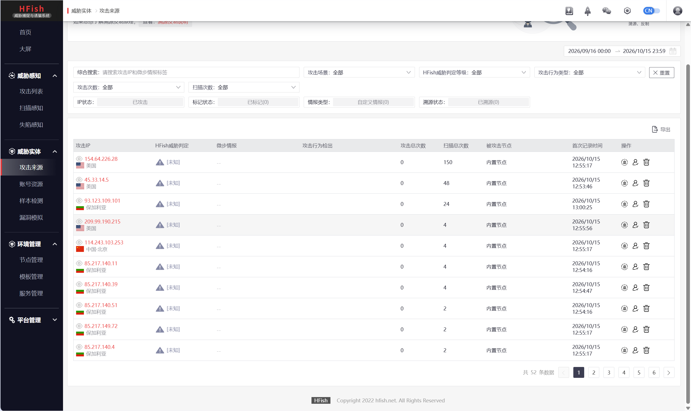

把端口放开

访问端口，随便登录一下。蜜罐可以看见攻击来源


还挺炫酷


2. 识别

   （1）蜜罐特性

   根据蜜罐特性，比如这个蜜罐的端口是4433，攻击时看见4433端口就往蜜罐上想。各种特性要自己多了解

   （2）[插件](https://github.com/graynjo/Heimdallr)

   这里不演示了，安装一个浏览器插件就可以，也有误报，自己甄别

   （3）360quake[工具](https://github.com/360quake/quake_rs)

   这个要钱，也不演示了，放个图

   

   （4）人工识别

   ```text
   - 看端口是否多而有规律（如 9001、9002、9003...）
   - 看端口是否开放大量 Web 服务
   - 访问非 HTTP 端口，看是否触发下载
   - 看端口返回的指纹是否异常 
   ```


   正常网站端口不是http协议就打不开，但是有些蜜罐会自动给你下载文件。

   比如ssh mysq1应用蜜罐搞一个可以爆破的地方

   爆破蜜罐会记录攻击者的账号密码

   账号密码会采用web jsonp去传输(web功能)

   转发 跳转jsonp去传输

   当你去web http去访问这个端口 采用协议去下载文件

   (5)网络空间

   ```
   - FOFA、Quake、Hunter 搜索目标 IP
   - 查看是否有“蜜罐”标签、端口规律、异常服务
   ```

---


### `CDN`的识别并获取真实ip

`cdn`主要是加速网站访问，将内容缓存到距离用户最近的节点。这会隐藏真实服务ip，域名会解析到`cdn`节点的`ip` ，会影响我们对信息的收集。CDN+WAF会使防护更强，真实ip更难找到。

```
国内常见CDN厂商

- 阿里云、百度云、七牛云、腾讯云、360、网宿科技、UCloud
- 国外：Cloudflare、Akamai、AWS CloudFront等
```


配置CDN时，可以选择对哪个域名进行加速，也可以选择加速范围，全球，中国内地，以及不包括内地的全球范围。

（1）加速域名时只加速了子域名

比如我的域名是`xuruo.date` 我我加速域名时只选择加速加速`www.xuruo.date` 就会导致我其他子域名依旧是原ip。下面是我托管到GitHub上域名，ip都不一样因为被加速过了

测试[网站](https://www.17ce.com/)

这是我没被加速的，在我一台vps上的的网站，没做cdn加速

打开我这个ip网站，显示的就是我配置的Nginx，这里访问的是默认80端口

我的网站是docker里面的配置了Nginx，直接输入ip只能看见Nginx欢迎页面，查了一下端口就能看见了

这里配置nginx主要是不想暴露我的docker端口，避免人人都能访问。

> 总之，如果只做了子域名的加速，可以通过其他域名查到真实ip

改一下host，ping一下确实变ip了，网页啥也没

（2）只加速了中国内地

道理很简单，如果CDN加速区域只选了“仅中国内地”，那么国外访问不会走CDN，直接解析到真实IP。如果加速区域选了“全球”，此方法无效。

（3）主动漏洞与遗留文件

1. 利用漏洞,`SSRF` `RCE`等。

   例如，某网站提供了一个远程图片加载功能：

   用户提交一个图片 URL。网站服务器主动请求这个 URL，下载图片。利用漏洞让对方真实服务器主动出网连接，判断来源IP即真实IP。

   在一台服务器上运行python2自带的http服务模块

   

   在这个有漏洞的网站输入ip以及端口

   

   在服务器上就会发现网站的真实ip请求过，它主动找你

   

2. 遗留文件：`phpinfo`类似功能
   通过访问类似`PHPINFO`类似代码函数获取本地IP造成的地址泄漏

   这里显示的就是运行这个网站的服务器的私网ip（关于ip的分配可以自行百度，这个ip地址是私网的）显示私网和公网是随机的，看运气了，私网就没啥用


（4）邮件系统找CDN

原因是邮件系统做不了cdn，一些厂商只允许CNAME这种记录类型的做cdn

1. 让网站主动给你发，邮件服务器如果向外部用户发送邮件的话，那么邮件头部的源码中会包含此邮件服务器的真实IP地址。一般用户忘记密码，网站会通过邮箱的方式的对密码进行充置换，在邮箱中可以看见真实ip

有的网站则不行，因为这些网站可以用的第三方邮件，返回的不是自己的ip而是邮箱第三方的

2. 你给未知邮箱发：（需要自己的邮件服务器不能第三方，比如用qq发邮箱，它返回的ip是qq的。后续有搭建邮件服务器）。
   通过发送邮件给一个不存在的邮箱地址，因为该用户邮箱不存在，所以发送将失败，
   并且还会收到一个包含发送该电子邮件给你的服务器的真实IP通知。

```常见的邮件触发点有：
常见的邮件触发点有：
1、RSS订阅
2、邮箱注册、激活处
3、邮箱找回密码处
4、产品更新的邮件推送
5、某业务执行后发送的邮件通知
6、员工邮箱、邮件管理平台等入口处的忘记密码
```

(5) 全网扫描

1、判断加速厂商,[厂商查询地址](https://tools.ipip.net/cdn.php)

e，我的不支持，目前看来我的网站都不支持复现这些，下面就用老师的图了

2、IP库筛地址段

[地址](https://www.cz88.net/geo-public) ，确定好服务商后，在ip库里服务商提供的ip，下面就是阿里云的

3、配置范围扫描
先从IP段去扫描符合开放端口，再从IP去访问看看关键字，将符合结果进行保存！

（1）扫描[工具](https://github.com/Tai7sy/fuckcdn).这个工具根据ip扫描的

先配置扫描的端口和网站地址以及关键字，一般选择标题。

这里因为本身知道真实ip地址，避免浪费时间直接选了ip端测试了，实战都要自己一个个测的。在目录里面ip文件里添加上选的ip

（2）这个[工具](https://github.com/Pluto-123/Bypass_cdn) 根据域名扫的

它需要提前准备好子域名，根据txt里的子域名扫的。这项目太老了，我让ChatGPT改了代码结果一直一直显示dns的问题，有空在解决吧。


[接口查询](https://get-site-ip.com/)（fofa查询的寄了）

我在这个网站查我的域名，这里会直接显现，当然有时候不一定准确


---

## 组件框架

框架是别人写好的、封装好的代码模板。 例如：文件上传功能，框架已经封装好了过滤、处理、存储等逻辑，你只需调用。
```
- 常见框架：
  - PHP：ThinkPHP、Laravel、Yii
  - Python：Django、Flask
  - Java：Spring、SpringBoot、Struts
```

> 框架的作用：把常用功能封装成函数，直接调用即可，不用一行行手写。


组件是第三方提供的、专一功能的模块。例如：日志记录、数据转换、缓存、消息队列等。组件只做一件事，不像框架那样大而全。
```
> 常见 Java 组件：Fastjson、Jackson、Log4j、Shiro、JWT、SpringBoot 等。
> 常见 PHP 组件：较少，一般以框架为主。
```

### web架构
通常web就这三种

| 模型 | 说明 | 特点 |
|---|---|---|
| **纯手写** | 功能代码全部自己写，不用框架和组件 | 最容易出漏洞，程序员水平参差不齐 |
| **框架开发** | 以框架为核心实现功能 | 框架有**过滤机制**，核心漏洞在框架本身 |
| **框架 + 组件** | 框架为核心，额外引入组件 | 需要关注框架漏洞 + 组件漏洞 |

#### python框架

（1）Django

```
- 常见特征：
  - 返回包中含有 `csrftoken` 字段
  - 数据包中有 `csrftoken` 相关 cookie
  - 插件（如 Wappalyzer）识别出 Python + Django
- 判定方式：抓包看返回，或看插件识别结果。
```

可以用插件识别

此外Django网站的数据包都还有个明显的特征`set-cookies` 这里格式大多这样


（2）flask

测了几个，插件没识别出来，但是数据包里很明显。注意不能认为数据包没有就不是flash。

#### php框架

(1)`ThinkPHP`

```
- 常见特征：
  - 返回包中含有 `ThinkPHP` 字样
  - 图标 ICO 为 ThinkPHP 官方图标
  - URL 路径、返回包、插件识别
- 判定方式：抓包、图标、插件、数据包特征。
```

识别插件,注意这些工具或者插件不一定全部能识别出来。


X-Powered-By: ThinkPHP数据包也会返回


CMS识别到源码体系TP开发，插件工具识别不到可以看源码识别


（2）`Laravel`

```
- 常见特征：
  - 返回包中含有 `laravel_session` cookie
  - 数据包中有 `XSRF-TOKEN` 字段
- 判定方式：抓包看 cookie 和返回包。
```

(3)`Yii`

```
- 常见特征：
  - 返回包中含有 `YII_CSRF_TOKEN` 字段
  - 数据包中有固定的 Yii 特征
- 判定方式：抓包看返回包。
```

#### Java框架和组件

52类110主流java组件和框架介绍[地址](https://blog.csdn.net/agonie201218/article/details/125300729) 

1）Spring / SpringBoot
```
- 常见特征：
  - 默认报错页面（Whitelabel Error Page）
  - 默认图标（SpringBoot 官方图标）
  - 返回包中的特定字段
- 判定方式：图标、报错页面、数据包特征。
```

（2）Struts
```
- 常见特征：
  - URL 后缀为 `.do` 或 `.action`
- 判定方式：URL 后缀。
```


识别 Fastjson/Jackson组件文章 [地址](https://forum.butian.net/share/1679)

(1) Shiro(身份验证组件)

```请求包的cookie中存在rememberMe字段。
- 返回包中存在set-Cookie：remeberMe=deleteMe。
- 请求包中存在rememberMe=x时，响应包中存在rememberMe=deleteMe。
- 有时候服务器不会主动返回remeberMe=deleteMe，直接发包即可，将Coo
- kie内容改为remember Me=1，若相应包有rememberMe=deleteMe，则基本可以确定网站apache shiro搭建的。
```

（2）Struts2

一般使用struts2框架后缀带do或action，可以尝试进行利用。有的识别出来，还是要自己多做。

| 组件 | 功能 | 识别方式 |
|---|---|---|
| **Fastjson** | JSON 数据转换 | 数据包中 id=01 被转为 1 |
| **Jackson** | JSON 数据转换 | 数据包中 id=01 抛异常 |
| **Shiro** | 身份验证、权限管理 | Cookie 中有 `rememberMe=deleteMe` |
| **Log4j** | 日志记录 | 无固定特征，需工具扫描 |
| **SpringBoot** | 快速开发框架 | 图标、报错页面 |
| **Solr** | 全局搜索服务器 | 默认端口 8983，图标 |
| **JWT** | 用户身份验证 | 数据包中 `eyJ` 开头的 token |
### CMS补充

主要针对内网的

用工具[GoToScan](https://github.com/newbe3three/gotoscan)


我这里一直卡住，不知道什么原因


---


# `APP`应用


## 获取`APP`

### 从名称获取

爱企查或者小蓝本，更推荐[点点](https://app.diandian.com/和[七麦](https://www.qimai.cn/)


建议多种平台搜索

### 从URL获取


1. **直接看官网**：很多网站首页或底部直接放了“下载客户端”、“APP下载”的按钮或链接。
2. **查备案信息**：
   - 复制网站域名，查 ICP 备案信息。
   - 找到背后的公司主体名称。
   - 用公司名称再去“点点数据”或“七麦”搜索 APP。
   - *注意*：如果没有备案，大概率是草根站点（没实力开发 APP）或违法站点（通常会在站内直接提供第三方下载地址，或需要信任证书安装）。
3. **应用市场搜索**：直接在苹果 App Store 或安卓各大应用市场（应用宝、豌豆荚等）搜索网站域名、品牌名、公司名。

这是查的备案信息


这个本身网站下面都有备案信息


## 信息分类与提取

抓到APP之后，就要提取信息了，主要提取**资产信息**（IP/域名/接口）、**泄露信息**（配置/密钥）、**代码信息**（加密/漏洞）。

通过获取App配置、数据包，去获取`url`、`api`、`osskey`、`js`等敏感信息。

###  提取技术

> 逆向静态提取

**原理**：将 APP 的安装包（APK/IPA）进行反编译，得到源码，然后通过工具或手工从源码中搜索特定的关键字（如 URL、IP、API 接口）。

**优缺点**：
- **优点**：不需要触发业务，直接看源码，能拿到隐藏较深的信息。
- **缺点**：**无法做到完整**。源码里没有的、加密的、拼接的，或者只有在特定交互下才会动态生成的 URL，静态分析提不出来。

[在线平台](https://www.zhihuaspace.cn:8888/)反编译从源码里搜集信息


静态分析工具[AppinfoScanner](https://github.com/kelvinBen/AppInfoScanner)

根据requirements安装的时候因为编码不一样发生报错，强制python使用utf-8的编码就好了

```python
set PYTHONUTF8=1
python -m pip install -r requirements.txt
```

还有就是windows终端默认编码gbk和工具冲突的报错，可以自己改文件的源码，也可以在终端默认一下

```cmd
set PYTHONUTF8=1
set PYTHONIOENCODING=utf-8
```


> 动态抓包提取


**原理**：将 APP 运行起来，通过配置代理（如 Burp Suite），拦截 APP 发出的网络请求，从而获取真实的 API 接口。

**优缺点**：
- **优点**：**没有误报**，抓到的都是真实交互的接口。
- **缺点**：**无法做到完整**。需要手动去点、去操作触发功能。如果不操作，就没有数据包。

**局限性**：
- 高级 APP 带有**证书校验（SSL Pinning）** 或**代理检测**，一旦设置了代理，APP 就会断网或崩溃，根本抓不到包。此时必须使用动态调试。

雷电模拟器抓包演示


> [!NOTE]
>
> 注意有些app打开无数据包，登录后才有数据包（反编译后也没找到目标资产，抓包才能找到），原因是登录页面是app在本地加载的资源，没发出数据。
>
> 还有就是哪怕抓包在登录页面就抓到了数据包，在线平台反编译也不一定能看见，因为代码里可以加密，通过解密才打开，反编译的网站用正则不一定可以搜索的哦啊

> 动态调试提取

**原理**：将本地搭建的 MobSF 平台与 Android 模拟器（如逍遥模拟器）连接。平台通过控制模拟器底层来抓取流量和记录操作逻辑，**无需设置代理**，绕过证书校验和代理检测。

**优缺点**：
- **优点**：解决了抓包抓不到的问题（无视证书校验）；能记录完整的操作流程、系统日志、本地存储等。
- **缺点**：需要安装配置环境；同样需要人去操作触发。

**操作流程**：
1. 本地启动 MobSF（`run.bat 0.0.0.0:8000`）。
2. 启动逍遥模拟器。
3. MobSF 上传 APK -> 静态分析 -> 点击“动态分析”。
4. 平台控制模拟器启动 APP，此时你在模拟器里的所有点击、输入、网络请求都会被实时记录并生成报告。

[MobSF](https://github.com/MobSF/Mobile-Security-Framework-MobSF),安装[教程](https://www.cnblogs.com/B-hai/p/15696948.html) 。

我docker搭建的，先静态分析一下


动态分析好像做不了，我模拟器是安卓14，不搞了。

## 
